<p align="center">
  <picture>
    <source media="(prefers-color-scheme: dark)" srcset="https://raw.githubusercontent.com/rich-iannone/edgecase/main/assets/readme/hero.dark.svg">
    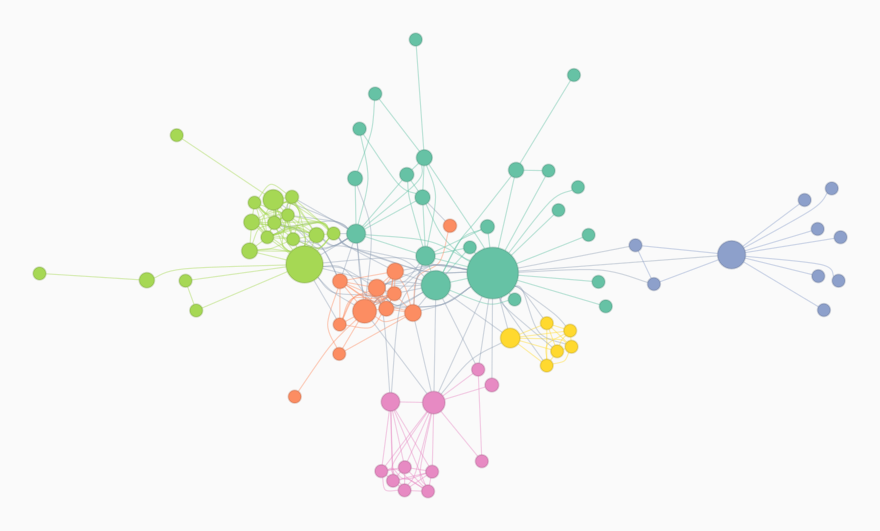
  </picture>
</p>

<h1 align="center">EdgeCase</h1>

<p align="center">
  <strong>Fast, friendly graph analysis for Python.</strong><br>
  A Rust core, Polars tables, Cypher queries and over 700 graph methods in one chainable API.
</p>

<p align="center">
  
  
  
  
</p>

<p align="center"><sub>Above: <code>ec.les_miserables().cmty_leiden().betweenness_centrality().plot(color_by="cmty_leiden", size_by="betweenness_centrality", palette="Set2")</code></sub></p>

---

## Why EdgeCase

- **Fast where it counts.** The core algorithms run in Rust. Louvain communities on a 23,000-node
  network take 24 ms (59× faster than NetworkX) and exact betweenness on the 4,941-node US
  power grid takes half a second (70× faster). See [Performance](#performance).
- **Your data stays in DataFrames.** Nodes and edges live in Polars tables. Every result can be
  stored as a column next to your own attributes, so analysis ends in a DataFrame you can
  filter, join and export.
- **Ask questions in Cypher.** `match()` runs Neo4j-style pattern queries (with `WHERE`,
  aggregation, `ORDER BY`, variable-length paths and `shortestPath`) and returns a DataFrame.
- **Select, then act.** Choose nodes or edges by pattern, degree, centrality or neighborhood, and
  then set attributes, delete, traverse or take a subgraph of just that selection.
- **Over 700 methods.** Paths, centrality, over a dozen community detection methods, flows,
  cuts, matching, coloring, isomorphism, spectral methods, DAGs, motifs, 85 graph generators,
  and toolkits for network biology and spreading processes.
- **Publication-ready pictures.** `plot()` draws a self-contained SVG in light or dark themes,
  with nodes colored and sized by any attribute. Interactive widgets and a GPU renderer for
  large graphs are one call away.
- **Every method illustrated.** 709 methods have their own diagram showing what they compute
  on a small example (see the [gallery](#every-method-illustrated)).
- **Validated.** Over 9,200 tests, including cross-checks against NetworkX and property-based
  tests. See [Tested and validated](#tested-and-validated).

## Installation

Install EdgeCase from PyPI:

```bash
pip install edgecase
```

EdgeCase runs on Python 3.10 and later, on macOS, Linux and Windows, with prebuilt wheels for
each, so no Rust toolchain is needed. The optional extras are `networkx` (conversion and
validation), `bio` (SciPy and scikit-learn for the network biology methods), `dev` and `all`:

```bash
pip install "edgecase[networkx]"
```

To install the development version from GitHub, which builds the Rust core and so needs a
[Rust toolchain](https://rustup.rs):

```bash
pip install git+https://github.com/rich-iannone/edgecase.git
```

## A 60-second tour

Load Zachary's Karate Club, find its communities and rank its members, all in one chain:

```python
import edgecase as ec

karate = ec.karate_club().cmty_louvain().pagerank()
karate
```

```
Name of Graph                  : Zachary's Karate Club
Number of nodes                : 34
Number of edges                : 78
Directed                       : False
Density                        : 0.14
Average degree (min, max)      : 4.59 (1, 17)
Connected                      : True
Number of connected components : 1
Tree                           : False
Bipartite                      : False

Computations:
  - cmty_louvain() -> attr: 'cmty_louvain' (34 of 34 nodes)
  - pagerank() -> attr: 'pagerank' (34 of 34 nodes)
```

Each method stored its result as a node attribute, so the node table already holds the answers.
It's a Polars DataFrame:

```python
(
    karate.get_node_df()
    .sort("pagerank", descending=True)
    .select("id", "label", "role", "faction", "cmty_louvain", "pagerank")
    .head(5)
)
```

```
shape: (5, 6)
┌─────┬───────┬───────────────┬─────────┬──────────────┬──────────┐
│ id  ┆ label ┆ role          ┆ faction ┆ cmty_louvain ┆ pagerank │
│ --- ┆ ---   ┆ ---           ┆ ---     ┆ ---          ┆ ---      │
│ i64 ┆ str   ┆ str           ┆ i64     ┆ i64          ┆ f64      │
╞═════╪═══════╪═══════════════╪═════════╪══════════════╪══════════╡
│ 34  ┆ 33    ┆ Administrator ┆ 2       ┆ 2            ┆ 0.100919 │
│ 1   ┆ 0     ┆ Instructor    ┆ 1       ┆ 0            ┆ 0.096998 │
│ 33  ┆ 32    ┆ Member        ┆ 2       ┆ 2            ┆ 0.071693 │
│ 3   ┆ 2     ┆ Member        ┆ 1       ┆ 0            ┆ 0.057079 │
│ 2   ┆ 1     ┆ Member        ┆ 1       ┆ 0            ┆ 0.052877 │
└─────┴───────┴───────────────┴─────────┴──────────────┴──────────┘
```

The two most central members are the club's administrator and its instructor, whose dispute
split the club in two. Did Louvain, which never saw the `faction` column, find that split? Ask
in Cypher:

```python
karate.match("""
    MATCH (n)
    RETURN n.faction AS faction, n.cmty_louvain AS community, count(*) AS members
    ORDER BY faction, community
""")
```

```
shape: (5, 3)
┌─────────┬───────────┬─────────┐
│ faction ┆ community ┆ members │
│ ---     ┆ ---       ┆ ---     │
│ i64     ┆ i64       ┆ i64     │
╞═════════╪═══════════╪═════════╡
│ 1       ┆ 0         ┆ 11      │
│ 1       ┆ 1         ┆ 5       │
│ 2       ┆ 0         ┆ 1       │
│ 2       ┆ 2         ┆ 11      │
│ 2       ┆ 3         ┆ 6       │
└─────────┴───────────┴─────────┘
```

It did: the four communities sit inside the two factions, with a single member on the wrong
side. To see it, color the nodes by community and size them by PageRank:

```python
karate.plot(color_by="cmty_louvain", size_by="pagerank", label_by="label")
```

<p align="center">
  <picture>
    <source media="(prefers-color-scheme: dark)" srcset="https://raw.githubusercontent.com/rich-iannone/edgecase/main/assets/readme/karate.dark.svg">
    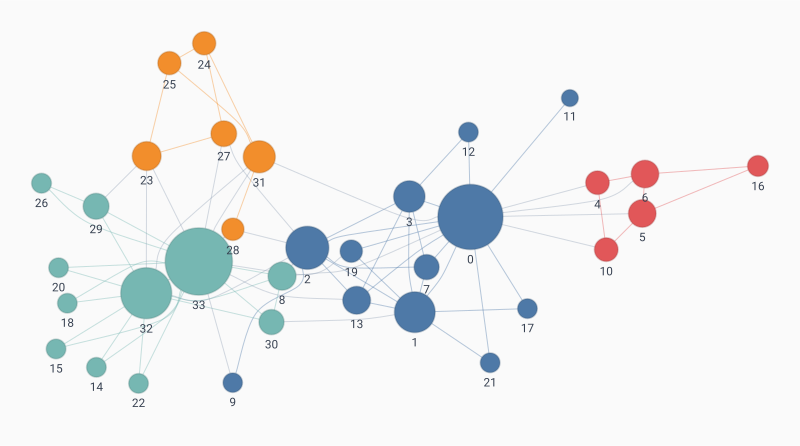
  </picture>
</p>

`plot()` returns an SVG that renders in notebooks and Quarto documents, and `.save("karate.svg")`
writes it to disk.

## Use cases

### Find the brokers in a network

Betweenness centrality measures how often a node lies on the shortest paths between others.
In the marriage network of Renaissance Florence, it singles out the family that famously
brokered its way to power:

```python
florentine = ec.florentine_families().betweenness_centrality()

(
    florentine.get_node_df()
    .sort("betweenness_centrality", descending=True)
    .select("label", "degree", "betweenness_centrality")
    .head(5)
)
```

```
shape: (5, 3)
┌──────────┬────────┬────────────────────────┐
│ label    ┆ degree ┆ betweenness_centrality │
│ ---      ┆ ---    ┆ ---                    │
│ str      ┆ i64    ┆ f64                    │
╞══════════╪════════╪════════════════════════╡
│ Medici   ┆ 6      ┆ 0.521978               │
│ Guadagni ┆ 4      ┆ 0.254579               │
│ Albizzi  ┆ 3      ┆ 0.212454               │
│ Salviati ┆ 2      ┆ 0.142857               │
│ Ridolfi  ┆ 3      ┆ 0.113553               │
└──────────┴────────┴────────────────────────┘
```

The Medici have only two more marriage ties than the Guadagni but twice the betweenness: on
average, more than half of the shortest paths between two other families run through them.

<p align="center">
  <picture>
    <source media="(prefers-color-scheme: dark)" srcset="https://raw.githubusercontent.com/rich-iannone/edgecase/main/assets/readme/florentine.dark.svg">
    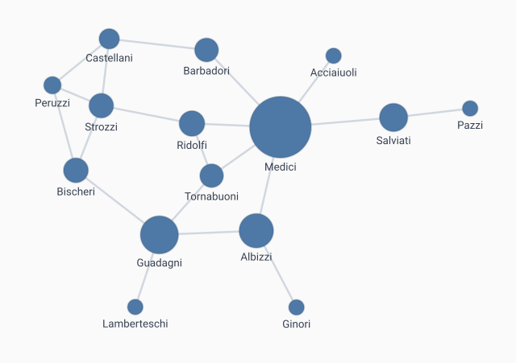
  </picture>
</p>

### Detect money moving in circles

Money that leaves an account and comes back through two intermediaries is a classic sign of
layering. In Cypher that's a three-node cycle, with the payment amounts stored as edge weights:

```python
payments = ec.Graph.from_edges(
    [
        ("Dee", "Eve", 80), ("Eve", "Dee", 25), ("Ana", "Dee", 120), ("Dee", "Ben", 60),
        ("Ben", "Eve", 300), ("Gus", "Dee", 45), ("Eve", "Finn", 2_000),
        ("Ana", "Ben", 9_500), ("Ben", "Cruz", 9_400), ("Cruz", "Ana", 9_300),
        ("Finn", "Gus", 4_950), ("Gus", "Hal", 4_900), ("Hal", "Finn", 4_850),
    ],
    directed=True,
)

payments.match("""
    MATCH (a)-[x]->(b)-[y]->(c)-[z]->(a)
    WHERE a.name < b.name AND a.name < c.name
    RETURN a.name AS a, b.name AS b, c.name AS c,
           x.weight AS a_to_b, y.weight AS b_to_c, z.weight AS c_to_a
    ORDER BY a_to_b DESC
""")
```

```
shape: (3, 6)
┌──────┬─────┬──────┬────────┬────────┬────────┐
│ a    ┆ b   ┆ c    ┆ a_to_b ┆ b_to_c ┆ c_to_a │
│ ---  ┆ --- ┆ ---  ┆ ---    ┆ ---    ┆ ---    │
│ str  ┆ str ┆ str  ┆ f64    ┆ f64    ┆ f64    │
╞══════╪═════╪══════╪════════╪════════╪════════╡
│ Ana  ┆ Ben ┆ Cruz ┆ 9500.0 ┆ 9400.0 ┆ 9300.0 │
│ Finn ┆ Gus ┆ Hal  ┆ 4950.0 ┆ 4900.0 ┆ 4850.0 │
│ Ben  ┆ Eve ┆ Dee  ┆ 300.0  ┆ 25.0   ┆ 60.0   │
└──────┴─────┴──────┴────────┴────────┴────────┘
```

(`a.name < b.name` lists each cycle once rather than once per starting point.) Two cycles move
nearly the same large amount around the loop, minus a small cut at each hop. `select_match()`
selects what a pattern matches so the next methods act on it. Here it flags the accounts in
the large cycles:

```python
ring = """
    MATCH (a)-[x]->(b)-[y]->(c)-[z]->(a)
    WHERE x.weight >= 1000 AND y.weight >= 1000 AND z.weight >= 1000
"""

(
    payments.select_match(ring)
    .set_node_attrs_ws(flag="ring")
    .invert_node_selection()
    .set_node_attrs_ws(flag="ok")
    .clear_selection()
    .plot(color_by="flag", label_by="label", palette="Set1")
)
```

<p align="center">
  <picture>
    <source media="(prefers-color-scheme: dark)" srcset="https://raw.githubusercontent.com/rich-iannone/edgecase/main/assets/readme/payments.dark.svg">
    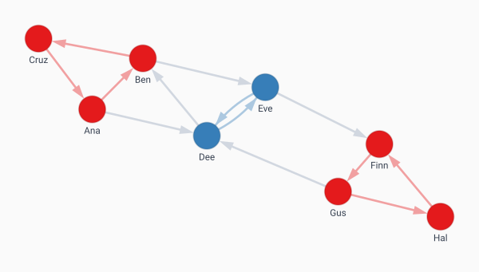
  </picture>
</p>

Every step is recorded, so the analysis documents itself:

```python
payments.steps
```

```
StepList([
    1  build_nodes    from_edges()
    2  query          match()
    3  select         select_match()
    4  mutate         set_node_attrs_ws()
    5  select         invert_node_selection()
    6  mutate         set_node_attrs_ws()
    7  select         clear_selection()
])
```

`play()` replays the log as an animation, one step at a time.

### Stress-test infrastructure

How much damage can a network take? `network_robustness()` removes nodes one at a time and
tracks the share left in the largest connected piece. On the US Western power grid, random
failures are survivable, but a targeted attack on the best-connected substations is not:

```python
grid = ec.power_grid()

for strategy in ["random", "degree", "betweenness"]:
    curve = grid.network_robustness(strategy=strategy, seed=1, return_dict=True)
    left = next(share for removed, share in curve if removed >= 0.05)
    print(f"{strategy:>11}: {left:.0%} of the grid still connected after losing 5% of substations")
```

```
     random: 92% of the grid still connected after losing 5% of substations
     degree: 52% of the grid still connected after losing 5% of substations
betweenness: 52% of the grid still connected after losing 5% of substations
```

<p align="center">
  <picture>
    <source media="(prefers-color-scheme: dark)" srcset="https://raw.githubusercontent.com/rich-iannone/edgecase/main/assets/readme/robustness.dark.svg">
    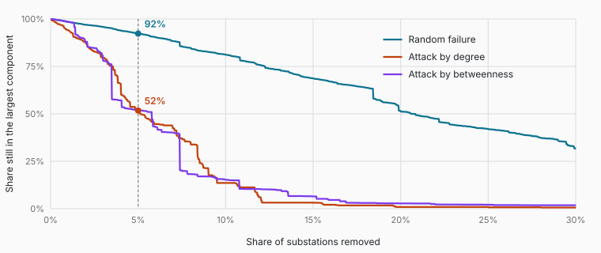
  </picture>
</p>

### Toolkits for domain work

- **Network biology:** propagate signals from seed genes with `random_walk_with_restart()` and
  `heat_diffusion()`, measure drug–disease `network_proximity()` (including the separation
  measure of Menche et al.), build co-expression modules with `soft_threshold_power()` and
  `topological_overlap()`, and test them with `module_annotation_enrichment()`.
- **Spreading and resilience:** `influence_maximization()` picks seed nodes for the widest
  spread, `voterank()` finds spreaders, and `node_percolation()`, `edge_percolation()` and
  `percolation_threshold_analysis()` find where a network falls apart.
- **Fraud and security:** pattern queries with `match()`, `simple_cycles()`, `k_core()` and
  `densest_subgraph()` for tight clusters, and link prediction with `adamic_adar_index()`,
  `jaccard_coefficient()` and `resource_allocation_index()`.
- **Logistics and planning:** `bidirectional_dijkstra()`, `astar_path()`, `k_shortest_paths()`,
  `maximum_flow()`, `minimum_cost_flow()`, `traveling_salesman()`, `steiner_tree()` and
  `minimum_spanning_tree()`.

## Every method, illustrated

Nearly every method's documentation opens with a diagram of what it computes on a small
graph. There are 709 of them, each in a light and a dark version. A few:

<p align="center">
  <picture>
    <source media="(prefers-color-scheme: dark)" srcset="https://raw.githubusercontent.com/rich-iannone/edgecase/main/assets/graphs/cmty-louvain.dark.svg">
    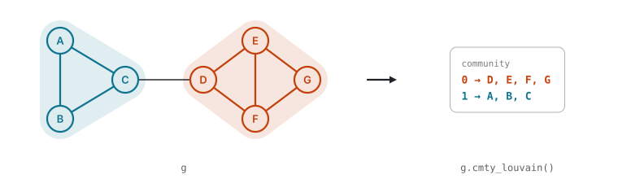
  </picture>
</p>
<p align="center">
  <picture>
    <source media="(prefers-color-scheme: dark)" srcset="https://raw.githubusercontent.com/rich-iannone/edgecase/main/assets/graphs/betweenness-centrality.dark.svg">
    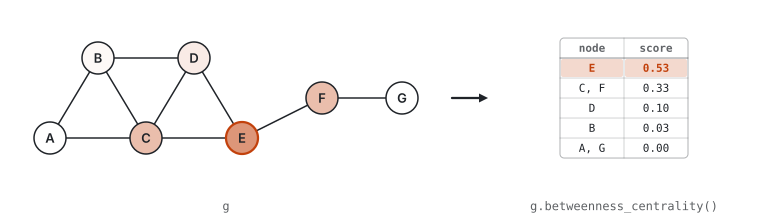
  </picture>
</p>
<p align="center">
  <picture>
    <source media="(prefers-color-scheme: dark)" srcset="https://raw.githubusercontent.com/rich-iannone/edgecase/main/assets/graphs/maximum-flow.dark.svg">
    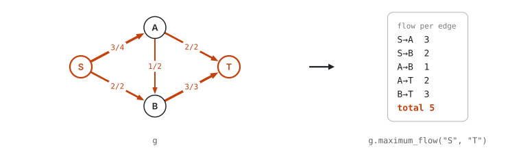
  </picture>
</p>
<p align="center">
  <picture>
    <source media="(prefers-color-scheme: dark)" srcset="https://raw.githubusercontent.com/rich-iannone/edgecase/main/assets/graphs/match.dark.svg">
    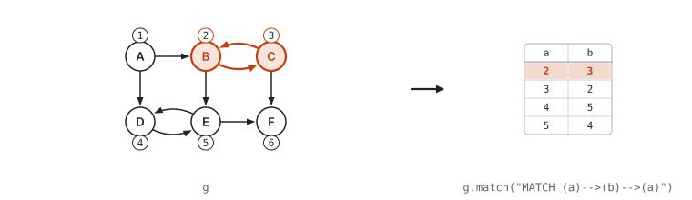(b)-->(a) finds the 2-cycles, shown as a table with one row per match.">
  </picture>
</p>

<details>
<summary>Three more</summary>

<p align="center">
  <picture>
    <source media="(prefers-color-scheme: dark)" srcset="https://raw.githubusercontent.com/rich-iannone/edgecase/main/assets/graphs/greedy-color.dark.svg">
    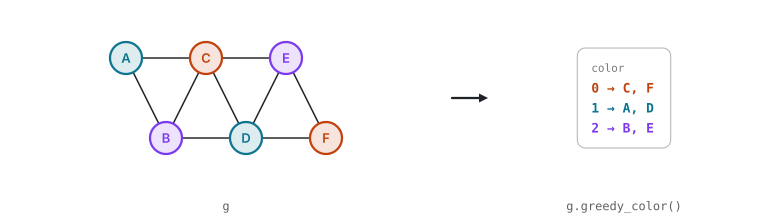
  </picture>
</p>
<p align="center">
  <picture>
    <source media="(prefers-color-scheme: dark)" srcset="https://raw.githubusercontent.com/rich-iannone/edgecase/main/assets/graphs/k-core.dark.svg">
    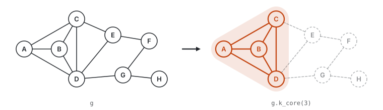
  </picture>
</p>
<p align="center">
  <picture>
    <source media="(prefers-color-scheme: dark)" srcset="https://raw.githubusercontent.com/rich-iannone/edgecase/main/assets/graphs/minimum-spanning-tree.dark.svg">
    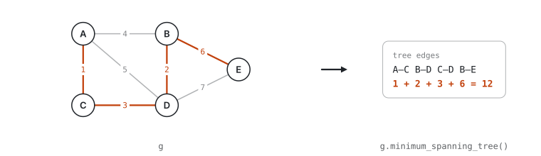
  </picture>
</p>

</details>

## Performance

EdgeCase against NetworkX and igraph on the same simple graphs, built from one edge list. Most
tasks use the condensed-matter co-authorship network (`ec.condmat()`: 23,133 nodes and 93,439
edges), and exact betweenness uses the power grid (4,941 nodes, 6,594 edges). Times are the
best of several runs, with results returned to Python.

<p align="center">
  <picture>
    <source media="(prefers-color-scheme: dark)" srcset="https://raw.githubusercontent.com/rich-iannone/edgecase/main/assets/readme/benchmarks.dark.svg">
    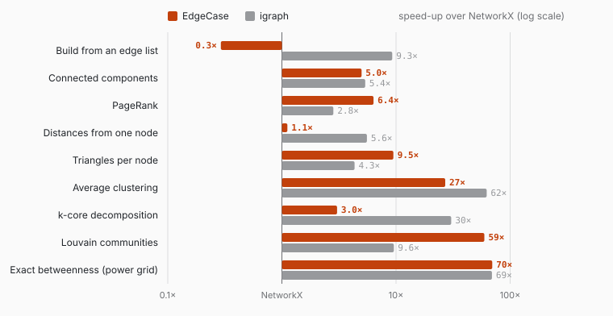
  </picture>
</p>

| Task                    | EdgeCase |  NetworkX |  igraph | Speed-up over NetworkX |
| :---------------------- | -------: | --------: | ------: | ---------------------: |
| Build from an edge list |   230 ms |   67.2 ms |  7.3 ms |                   0.3× |
| Connected components    |   2.7 ms |   13.4 ms |  2.5 ms |                   5.0× |
| PageRank                |  13.1 ms |   83.1 ms | 29.4 ms |                   6.4× |
| Distances from one node |  12.9 ms |   14.5 ms |  2.6 ms |                   1.1× |
| Triangles per node      |  11.3 ms |    107 ms | 24.7 ms |                   9.5× |
| Average clustering      |  15.1 ms |    409 ms |  6.6 ms |                    27× |
| k-core decomposition    |  21.7 ms |   66.0 ms |  2.2 ms |                   3.0× |
| Louvain communities     |  23.6 ms |  1,401 ms |  146 ms |                    59× |
| Exact betweenness       |   526 ms | 36,644 ms |  529 ms |                    70× |

<sub>Apple M3 Pro, Python 3.13, NetworkX 3.5, python-igraph 1.0. Reproduce with
`python scripts/readme_benchmarks.py`.</sub>

A few notes, to be fair to everyone:

- **Building a graph is slower than in NetworkX** (and much slower than in igraph). It's a
  one-time cost, which the first algorithm call usually repays.
- **igraph is a C library and is often faster**, and EdgeCase's goal isn't to beat it on every
  kernel. EdgeCase is faster on PageRank, triangles and Louvain, and on par for components and
  betweenness.
- **Faster doesn't mean looser.** Louvain finds partitions of the same quality as NetworkX's
  (modularity 0.730 against 0.731 on `condmat`), and EdgeCase's PageRank at its default
  settings is closer to the fully converged answer than NetworkX's default (error 8.5e-9
  against 5.4e-5).

## Tested and validated

- **Over 9,200 Python tests and 236 Rust tests**, in 185 Python test files.
- **Cross-checked against NetworkX**: 87 of those files compare results with NetworkX on the
  same graphs.
- **Property-based tests** with [Hypothesis](https://hypothesis.readthedocs.io), which generate
  random graphs and Cypher queries and check invariants that must always hold.

## Works with what you have

EdgeCase has 28 readers (`from_*()`) and 28 writers (`to_*()`):

| Kind            | Formats                                                                                   |
| :-------------- | :---------------------------------------------------------------------------------------- |
| Libraries       | NetworkX, igraph, Cytoscape (JSON)                                                         |
| Arrays & frames | NumPy, SciPy sparse, Pandas (edge lists and adjacency), Polars (native)                    |
| Graph files     | GraphML, GEXF, GML, DOT, Pajek, LEDA, graph6, sparse6, SIF, TSV edge lists, Matrix Market (read), LaTeX/TikZ (write) |
| Structured data | Cypher (`CREATE` statements), node-link and adjacency JSON, tree data, dicts of dicts and lists, adjacency lists |

```python
import networkx as nx
import polars as pl

g = ec.from_networkx(nx.florentine_families_graph())  # and back with ec.to_networkx(g)
ig_graph = ec.to_igraph(g)
ec.to_graphml(g, "florentine.graphml")

flights = pl.DataFrame({
    "from": ["SEA", "SEA", "SFO", "DEN"],
    "to": ["SFO", "DEN", "LAX", "ORD"],
    "minutes": [125, 165, 90, 155],
})
routes = ec.from_pandas_edgelist(flights, source="from", target="to", edge_attr="minutes")
```

`from_pandas_edgelist()` takes Polars DataFrames as well as Pandas ones.

## What's inside

<details>
<summary>The method families, with some of their members</summary>

| Family                    | Examples                                                                                                                                                    |
| :------------------------ | :---------------------------------------------------------------------------------------------------------------------------------------------------------- |
| Paths and traversal       | `shortest_path()`, `astar_path()`, `bellman_ford_shortest_path()`, `floyd_warshall()`, `johnson()`, `k_shortest_paths()`, `bfs()`, `dfs()`, `eulerian_circuit()` |
| Centrality                | `betweenness_centrality()`, `closeness_centrality()`, `harmonic_centrality()`, `eigen_centrality()`, `katz_centrality()`, `pagerank()`, `current_flow_betweenness_centrality()`, `percolation_centrality()`, `voterank()` |
| Communities               | `cmty_louvain()`, `cmty_leiden()`, `cmty_walktrap()`, `cmty_label_propagation()`, `cmty_fluid()`, `cmty_girvan_newman()`, `cmty_stochastic_block_model()`, `modularity()` |
| Connectivity and flow     | `weakly_connected_components()`, `bridges()`, `articulation_points()`, `k_components()`, `stoer_wagner()`, `gomory_hu_tree()`, `maximum_flow()`, `minimum_cost_flow()` |
| Cores, cliques and motifs | `k_core()`, `k_truss()`, `find_cliques()`, `maximum_clique()`, `count_triangles()`, `motif_census()`, `triadic_census()`, `rich_club_coefficient()` |
| Coloring and matching     | `greedy_color()`, `edge_coloring()`, `maximum_weight_matching()`, `bipartite_maximum_matching()`, `dominating_set()`, `maximum_independent_set()` |
| Similarity and isomorphism | `is_isomorphic()`, `subgraph_isomorphisms()`, `weisfeiler_lehman_graph_hash()`, `graph_edit_distance()`, `simrank_similarity()`, `adamic_adar_index()` |
| DAGs and trees            | `topological_generations()`, `dag_longest_path()`, `transitive_reduction()`, `immediate_dominators()`, `minimum_spanning_tree()`, `steiner_tree()`, `tree_decomposition()` |
| Spectral                  | `laplacian_matrix()`, `adjacency_spectrum()`, `fiedler_vector()`, `algebraic_connectivity()`, `spectral_bisection()`, `magnetic_laplacian_matrix()` |
| Building graphs           | 85 generators (`add_gnp_graph()`, `add_lfr_graph()`, `add_smallworld_graph()`, ...), 20 bundled datasets, set operations, products and `from_cypher()` |
| Plotting                  | `plot()` (static SVG), `plot_vis()` (interactive), `plot_cosmo()` (GPU, for large graphs), `plot_traversal()`, `play()`, and 13 `layout_*()` methods |

</details>

## Documentation

The [documentation site](https://rich-iannone.github.io/edgecase/) has a User Guide of more
than 30 chapters (from building graphs to Cypher, communities, plotting, network biology and
spreading processes), a glossary, and a reference page for every method, nearly all with a
diagram.

## Stability

EdgeCase is in alpha, and its API may change before 1.0.

## License

EdgeCase is licensed under the MIT License. See
[LICENSE](https://github.com/rich-iannone/edgecase/blob/main/LICENSE) for details.
