# Doc graphics — maintainer index

Generated by `scripts/generate_doc_graphics.py`. Do not edit by hand.

Each figure is emitted as `<slug>.light.svg` and `<slug>.dark.svg`.
The Great Docs lightbox picks the dark sibling automatically in dark
mode; docstrings only ever reference the `.light.svg` file.

See `DOC_GRAPHICS_PLAN.md` at the repo root for the design.

## `op-add-node` — Add node

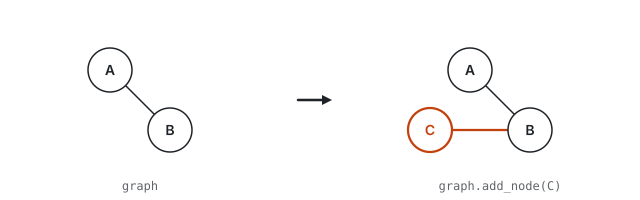

**Copy-paste snippet for docstrings:**

```markdown
{.lightbox fig-alt="A graph gains a new node connected to an existing node. The new node and its new edge are shown in the accent color." width="100%"}
```

## `op-delete-node` — Delete node

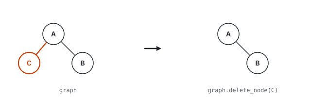

**Copy-paste snippet for docstrings:**

```markdown
{.lightbox fig-alt="A graph loses one node and its incident edge. The doomed node and edge are highlighted in the accent color before removal." width="100%"}
```

## `algo-delete-nodes-ws` — Delete nodes (working selection)

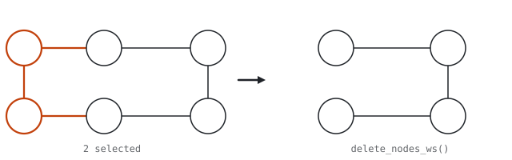

**Copy-paste snippet for docstrings:**

```markdown
{.lightbox fig-alt="Before: six nodes with two selected in accent along with their incident edges. After: the two selected nodes and their edges are removed, leaving four nodes." width="100%"}
```

## `op-add-edge` — Add edge

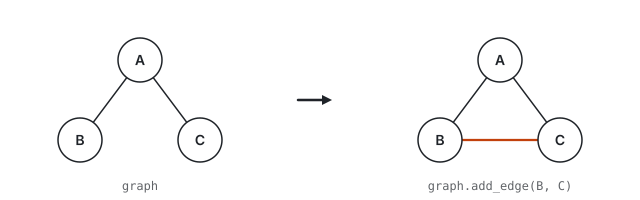

**Copy-paste snippet for docstrings:**

```markdown
{.lightbox fig-alt="A graph gains one edge between two existing nodes. The new edge is shown in the accent color." width="100%"}
```

## `op-delete-edge` — Delete edge

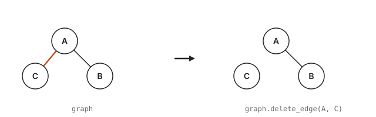

**Copy-paste snippet for docstrings:**

```markdown
{.lightbox fig-alt="A graph loses one edge. The doomed edge is highlighted in the accent color before removal; every node remains in place afterward." width="100%"}
```

## `algo-delete-edge-by-id` — Delete edge by ID

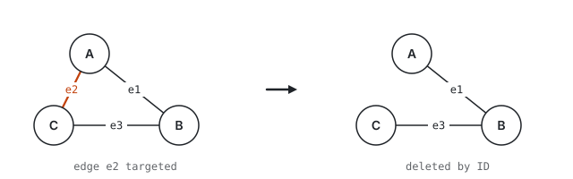

**Copy-paste snippet for docstrings:**

```markdown
{.lightbox fig-alt="A before-and-after pair. On the left, a triangle with three edges labeled e1, e2, e3; edge e2 is highlighted in accent. On the right, edge e2 has been removed by its ID, leaving only e1 and e3." width="100%"}
```

## `op-delete-edges-ws` — Delete edges from selection

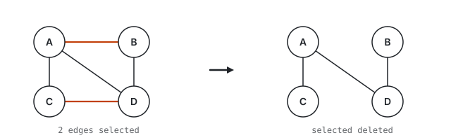

**Copy-paste snippet for docstrings:**

```markdown
{.lightbox fig-alt="A before-and-after pair. On the left, a four-node graph with two accent edges selected. On the right, those two edges have been removed while the rest of the graph is unchanged." width="100%"}
```

## `op-contract-nodes` — Contract nodes

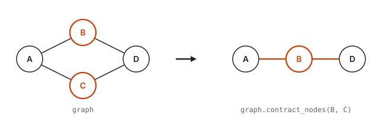

**Copy-paste snippet for docstrings:**

```markdown
{.lightbox fig-alt="Two nodes merge into one. Node C is absorbed into node B, which keeps its label; C's incident edges are rerouted to B, and duplicate edges collapse." width="100%"}
```

## `algo-contract-multi` — Multi-node contraction

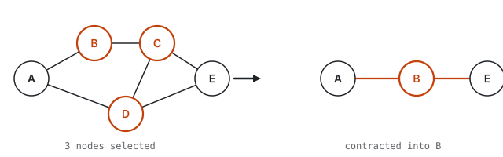

**Copy-paste snippet for docstrings:**

```markdown
{.lightbox fig-alt="A before-and-after pair. On the left, a five-node graph with three nodes B, C, D highlighted in accent. On the right, those three have been contracted into a single node B, with edges rerouted to the surviving node." width="100%"}
```

## `algo-contracted-edge` — Contracted edge

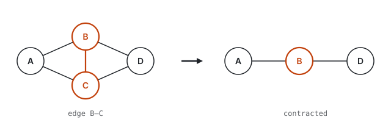

**Copy-paste snippet for docstrings:**

```markdown
{.lightbox fig-alt="Before: four nodes with accent edge B–C highlighted. After: C is merged into B; duplicate edges collapse. The result has three nodes." width="100%"}
```

## `op-simplify` — Simplify

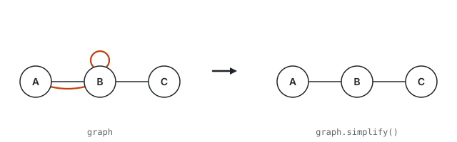

**Copy-paste snippet for docstrings:**

```markdown
{.lightbox fig-alt="On the left, a three-node graph with a duplicate parallel edge between A and B and a self-loop on B, both highlighted in the accent color. On the right, the same graph after simplify(): the duplicate edge and the self-loop are gone, leaving a simple path A - B - C." width="100%"}
```

## `algo-is-simple` — Simple graph test

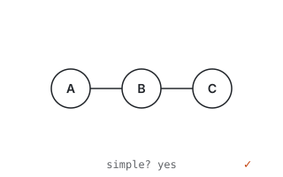

**Copy-paste snippet for docstrings:**

```markdown
{.lightbox fig-alt="A three-node path graph A–B–C with no self-loops or parallel edges. A caption reads 'simple? yes' with a checkmark." width="100%"}
```

## `op-reverse` — Reverse edges

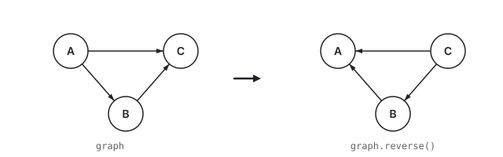

**Copy-paste snippet for docstrings:**

```markdown
{.lightbox fig-alt="A directed three-node graph on the left with three arrows; on the right, the same graph with every arrow flipped to point in the opposite direction." width="100%"}
```

## `op-reverse-ws` — Reverse selected edges

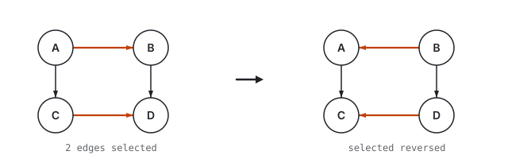

**Copy-paste snippet for docstrings:**

```markdown
{.lightbox fig-alt="A before-and-after pair of a four-node directed graph. On the left, two accent edges A→B and C→D are selected. On the right, only those two edges have been reversed (B→A and D→C) while the other edges remain unchanged." width="100%"}
```

## `algo-rev-edge-dir-ws` — Reverse selected edge direction

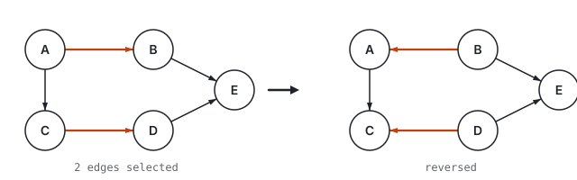

**Copy-paste snippet for docstrings:**

```markdown
{.lightbox fig-alt="A before-and-after pair of a five-node directed graph. On the left, two accent edges A→B and C→D are selected. On the right, only those two edges have been reversed (B→A and D→C) while the other three edges remain unchanged." width="100%"}
```

## `op-to-directed` — Convert to directed

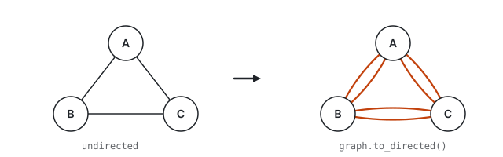

**Copy-paste snippet for docstrings:**

```markdown
{.lightbox fig-alt="On the left, a three-node undirected triangle with three plain edges. On the right, the same triangle after to_directed(): every original undirected edge has been replaced by a mutual pair of accent-colored directed arrows curved in opposite directions, so the total edge count doubles from three to six." width="100%"}
```

## `op-to-undirected` — Convert to undirected

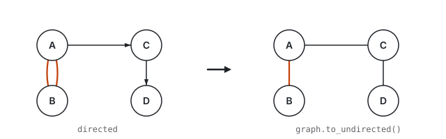

**Copy-paste snippet for docstrings:**

```markdown
{.lightbox fig-alt="On the left, a four-node directed graph with a mutual A - B pair drawn as two accent-colored curved arrows, plus two asymmetric directed edges A to C and C to D. On the right, the same nodes after to_undirected(): the mutual pair collapses into a single accent-colored undirected A - B edge, and each asymmetric edge simply loses its arrowhead." width="100%"}
```

## `op-subgraph` — Induced subgraph

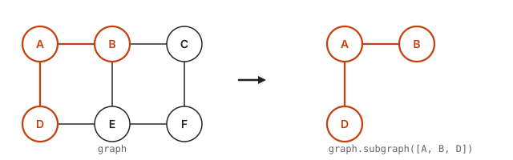

**Copy-paste snippet for docstrings:**

```markdown
{.lightbox fig-alt="On the left, a six-node graph with three nodes (A, B, D) and the two edges among them highlighted in the accent color. On the right, only that induced subgraph remains: three accent nodes and the two accent edges connecting them." width="100%"}
```

## `algo-subgraph-ws` — Subgraph from selection

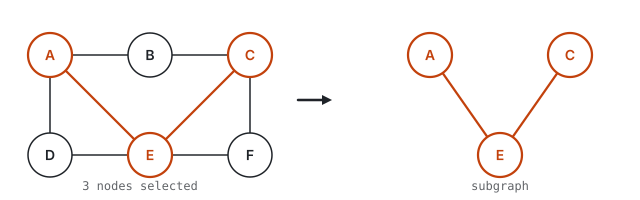

**Copy-paste snippet for docstrings:**

```markdown
{.lightbox fig-alt="A before-and-after pair. On the left, a six-node graph with three nodes A, C, E highlighted in accent. On the right, only those three nodes remain with the two edges between them, forming the induced subgraph." width="100%"}
```

## `op-edge-subgraph` — Edge-induced subgraph

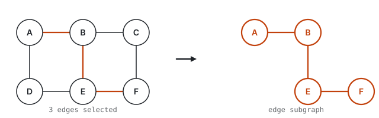

**Copy-paste snippet for docstrings:**

```markdown
{.lightbox fig-alt="On the left, a six-node graph with three edges highlighted in accent. On the right, the edge-induced subgraph: only the three selected edges and their four endpoint nodes remain, all in accent." width="100%"}
```

## `op-complement` — Complement

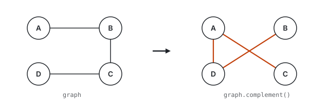

**Copy-paste snippet for docstrings:**

```markdown
{.lightbox fig-alt="On the left, a four-node graph with three edges forming an open path A - B - C - D. On the right, the same nodes with the complementary set of three edges (the ones absent from the original graph) shown in the accent color." width="100%"}
```

## `struct-tree` — Tree structure

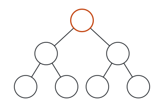

**Copy-paste snippet for docstrings:**

```markdown
{.lightbox fig-alt="A small rooted tree with seven nodes. The root is shown in the accent color; the remaining nodes form two branches of two leaves each." width="100%"}
```

## `struct-forest` — Forest

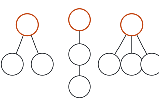

**Copy-paste snippet for docstrings:**

```markdown
{.lightbox fig-alt="A forest with three disjoint tree components: a small Y-shaped tree on the left, a three-node path in the middle, and a one-to-three fan on the right. The root of each tree is shown in the accent color; no edge runs between the three components." width="100%"}
```

## `struct-arborescence` — Arborescence

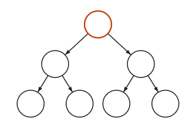

**Copy-paste snippet for docstrings:**

```markdown
{.lightbox fig-alt="A seven-node rooted directed tree (arborescence). The root at the top is drawn in the accent color; every edge carries an arrowhead pointing away from the root, so each non-root node has exactly one incoming edge." width="100%"}
```

## `struct-balanced-tree` — Balanced tree

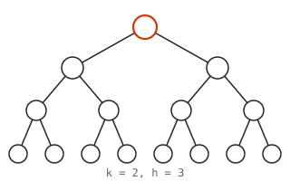

**Copy-paste snippet for docstrings:**

```markdown
{.lightbox fig-alt="A complete binary tree of height 3: fifteen nodes on four levels (1 + 2 + 4 + 8). Every internal node has exactly two children and every leaf sits at the same depth, illustrating the balanced structure produced by add_balanced_tree(k=2, h=3). The root at the top is shown in the accent color." width="100%"}
```

## `struct-star` — Star structure

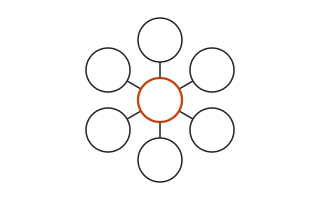

**Copy-paste snippet for docstrings:**

```markdown
{.lightbox fig-alt="A star graph with one central hub connected to six peripheral spokes. The hub is shown in the accent color." width="100%"}
```

## `struct-path` — Path structure

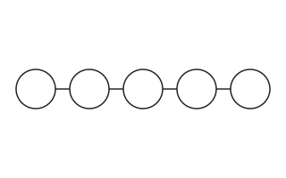

**Copy-paste snippet for docstrings:**

```markdown
{.lightbox fig-alt="A path graph: five nodes connected end-to-end in a single line, with four edges." width="100%"}
```

## `struct-cycle` — Cycle structure

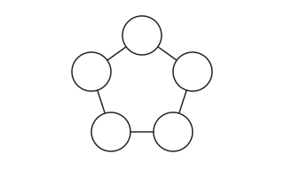

**Copy-paste snippet for docstrings:**

```markdown
{.lightbox fig-alt="A cycle graph: five nodes arranged in a ring, each connected to its two immediate neighbors, closing back to the start." width="100%"}
```

## `algo-has-cycles` — Cycle detection

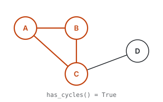

**Copy-paste snippet for docstrings:**

```markdown
{.lightbox fig-alt="A four-node graph where nodes A, B, and C form a triangle highlighted in the accent color, indicating a detected cycle. Node D connects to C with a default edge outside the cycle. A caption below reads has_cycles() = True." width="100%"}
```

## `algo-simple-cycles` — Simple cycles

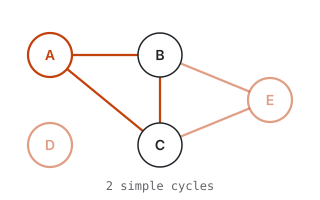

**Copy-paste snippet for docstrings:**

```markdown
{.lightbox fig-alt="A five-node graph containing two simple cycles. Nodes A, B, and C form a triangle highlighted in accent. Nodes B, E, and C form a second cycle in a lighter accent tint. A caption below reads 2 simple cycles." width="100%"}
```

## `algo-simple-cycles-enum` — Enumerate simple cycles

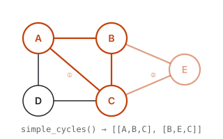

**Copy-paste snippet for docstrings:**

```markdown
{.lightbox fig-alt="A five-node graph with two simple cycles enumerated. Triangle A-B-C is highlighted in accent and labeled 1. Triangle B-E-C is highlighted in lighter accent and labeled 2. A caption lists both cycles." width="100%"}
```

## `struct-complete` — Complete graph

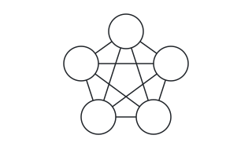

**Copy-paste snippet for docstrings:**

```markdown
{.lightbox fig-alt="A complete graph on five nodes: every pair of nodes is joined by an edge, giving ten edges in total." width="100%"}
```

## `algo-regular` — Regular graph

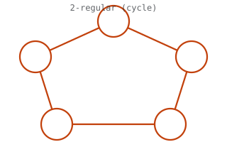

**Copy-paste snippet for docstrings:**

```markdown
{.lightbox fig-alt="A five-node cycle graph in accent where every node has exactly degree 2. A caption reads '2-regular (cycle)', illustrating that a k-regular graph has every vertex with the same degree k." width="100%"}
```

## `algo-is-k-regular` — k-regular test

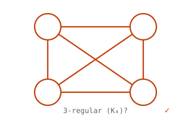

**Copy-paste snippet for docstrings:**

```markdown
{.lightbox fig-alt="A four-node complete graph K4 with all nodes and edges in accent. Every node has degree 3. A caption asks '3-regular (K4)?' with a checkmark confirming yes." width="100%"}
```

## `op-fully-connect` — Fully connect nodes

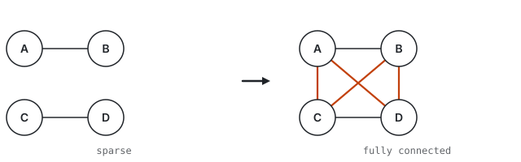

**Copy-paste snippet for docstrings:**

```markdown
{.lightbox fig-alt="A before-and-after pair. On the left, four nodes with only two edges. On the right, four new accent edges have been added so every pair of nodes is connected, forming a complete subgraph." width="100%"}
```

## `struct-triangle` — Triangle

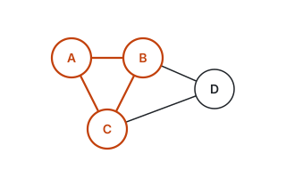

**Copy-paste snippet for docstrings:**

```markdown
{.lightbox fig-alt="A four-node graph in which the triangle formed by nodes A, B, and C is highlighted in the accent color; a fourth node D connects to B and C in default styling." width="100%"}
```

## `algo-list-triangles` — List triangles

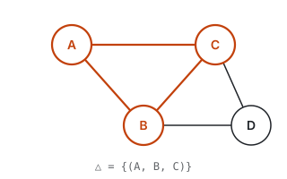

**Copy-paste snippet for docstrings:**

```markdown
{.lightbox fig-alt="A four-node graph with one triangle A–B–C highlighted in accent. An extra node D connects to B and C but does not form a second triangle. A caption reads '△ = {(A, B, C)}'." width="100%"}
```

## `struct-components` — Connected components

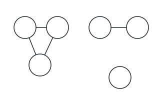

**Copy-paste snippet for docstrings:**

```markdown
{.lightbox fig-alt="A graph containing three disjoint connected components: a triangle on the left, a two-node edge in the upper right, and a single isolated node in the lower right." width="100%"}
```

## `algo-is-connected` — Connectivity test

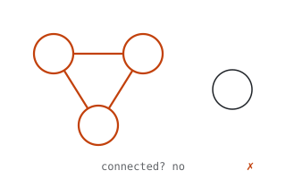

**Copy-paste snippet for docstrings:**

```markdown
{.lightbox fig-alt="A four-node graph: three accent nodes form a connected triangle, while a fourth node sits isolated. A caption reads 'connected? no' with an X mark." width="100%"}
```

## `algo-count-wcc` — Count weakly connected components

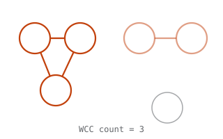

**Copy-paste snippet for docstrings:**

```markdown
{.lightbox fig-alt="A graph with three disjoint components, each tinted differently: a triangle in the accent color, a two-node edge in a lighter accent tint, and a single isolated node in muted ink. A caption below reads WCC count = 3." width="100%"}
```

## `algo-wcc-list` — Weakly connected components list

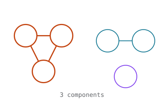

**Copy-paste snippet for docstrings:**

```markdown
{.lightbox fig-alt="A six-node graph with three components: a triangle in accent, a pair in teal, and an isolate in violet. A caption reads '3 components'." width="100%"}
```

## `algo-is-weakly-connected` — Weakly connected test

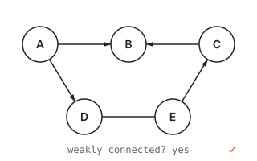

**Copy-paste snippet for docstrings:**

```markdown
{.lightbox fig-alt="A five-node directed graph where every node can reach every other when edge direction is ignored. A caption reads 'weakly connected? yes' with a checkmark." width="100%"}
```

## `algo-count-scc` — Count strongly connected components

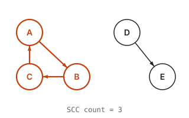

**Copy-paste snippet for docstrings:**

```markdown
{.lightbox fig-alt="A directed graph with five nodes. Nodes A, B, and C form a directed cycle highlighted in the accent color, constituting one strongly connected component. Nodes D and E are connected by a single directed edge and form two singleton SCCs. A caption below reads SCC count = 3." width="100%"}
```

## `algo-scc-list` — Strongly connected component listing

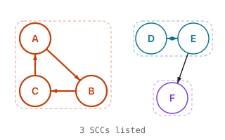

**Copy-paste snippet for docstrings:**

```markdown
{.lightbox fig-alt="A directed graph partitioned into three strongly connected components. A three-node cycle A-B-C is enclosed in an accent dashed box. A two-node mutual pair D-E is enclosed in a teal dashed box. Singleton F sits in a purple dashed box. A caption reads '3 SCCs listed'." width="100%"}
```

## `algo-is-strongly-connected` — Strongly connected test

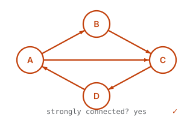

**Copy-paste snippet for docstrings:**

```markdown
{.lightbox fig-alt="A four-node directed graph forming a cycle A→B→C→D→A with an additional shortcut A→C, all in accent. Every node can reach every other following edge directions. A caption reads 'strongly connected? yes' with a checkmark." width="100%"}
```

## `algo-largest-component` — Largest component size

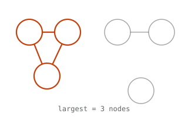

**Copy-paste snippet for docstrings:**

```markdown
{.lightbox fig-alt="A graph with three disjoint components. The largest component, a triangle of three nodes, is highlighted in the accent color. A two-node edge and a single isolated node are drawn in muted ink. A caption below reads largest = 3 nodes." width="100%"}
```

## `struct-community` — Community structure

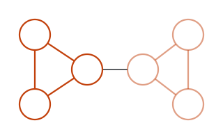

**Copy-paste snippet for docstrings:**

```markdown
{.lightbox fig-alt="Two triangular clusters of three nodes each, tinted with the two accent shades so that each community is visually distinct. A single edge in default styling bridges the two clusters." width="100%"}
```

## `struct-bridge` — Bridge edge

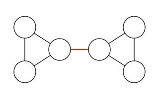

**Copy-paste snippet for docstrings:**

```markdown
{.lightbox fig-alt="Two triangular clusters of three nodes each, joined by a single edge shown in the accent color. Removing that bridge edge would disconnect the graph into two components." width="100%"}
```

## `algo-has-bridges` — Bridge existence test

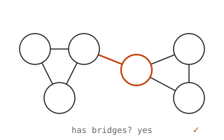

**Copy-paste snippet for docstrings:**

```markdown
{.lightbox fig-alt="A six-node graph with two triangular clusters connected by a single accent bridge edge. A caption reads 'has bridges? yes' with a checkmark." width="100%"}
```

## `algo-betweenness` — Betweenness centrality

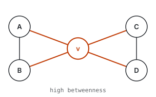

**Copy-paste snippet for docstrings:**

```markdown
{.lightbox fig-alt="A five-node graph where node v sits on every shortest path between the left pair (A, B) and the right pair (C, D). The four accent edges through v show it as the sole bridge, giving it high betweenness centrality. A caption reads 'high betweenness'." width="100%"}
```

## `algo-cmty-edge-btwns` — Edge-betweenness communities


**Copy-paste snippet for docstrings:**

```markdown
{.lightbox fig-alt="A before-and-after pair. On the left, two triangular clusters joined by a single accent edge with the highest edge betweenness. On the right, that edge has been removed, revealing two communities colored in teal and purple." width="100%"}
```

## `algo-edge-clustering` — Edge clustering coefficient


**Copy-paste snippet for docstrings:**

```markdown
{.lightbox fig-alt="A five-node graph. The edge A-B is drawn in accent. The triangle A-B-C is shaded with a faint accent fill, showing one triangle that contains the focal edge. Two other nodes D and E provide additional edges but no second triangle through A-B. A caption reads 'edge cc(A,B) = 0.5'." width="100%"}
```

## `struct-directed-vs-undirected` — Directed vs. undirected


**Copy-paste snippet for docstrings:**

```markdown
{.lightbox fig-alt="The same three-node graph shown twice. On the left, edges are drawn without arrowheads, representing an undirected graph. On the right, the same edges carry arrowheads showing direction, representing a directed graph." width="100%"}
```

## `struct-weighted` — Weighted graph


**Copy-paste snippet for docstrings:**

```markdown
{.lightbox fig-alt="A weighted graph: three nodes on a path, with each edge carrying a numeric weight label centered along the edge." width="100%"}
```

## `struct-bipartite` — Bipartite graph


**Copy-paste snippet for docstrings:**

```markdown
{.lightbox fig-alt="A bipartite graph: six nodes arranged in two rows of three, with edges connecting only nodes in different rows; no edges run within a row." width="100%"}
```

## `struct-self-loop` — Self-loop


**Copy-paste snippet for docstrings:**

```markdown
{.lightbox fig-alt="A two-node graph with one regular edge between the nodes and one self-loop attached to the first node, shown in the accent color." width="100%"}
```

## `algo-self-loop-query` — Self-loop count


**Copy-paste snippet for docstrings:**

```markdown
{.lightbox fig-alt="A three-node graph where nodes A and C each have a self-loop drawn in accent. A small overlay reads 'loops = 2', illustrating methods that count or identify self-loops." width="100%"}
```

## `algo-count-loops` — Count self-loops per node


**Copy-paste snippet for docstrings:**

```markdown
{.lightbox fig-alt="A four-node graph where node A has one self-loop and node C has two self-loops, all drawn in accent. A HUD overlay reads A: 1, C: 2, showing per-node loop counts." width="100%"}
```

## `algo-loop-count` — Self-loop count (total)


**Copy-paste snippet for docstrings:**

```markdown
{.lightbox fig-alt="A three-node graph where nodes A and C each have a self-loop drawn in accent. A HUD overlay reads 'total = 2', showing the aggregate count of all self-loops in the graph." width="100%"}
```

## `struct-multigraph` — Multi-edge


**Copy-paste snippet for docstrings:**

```markdown
{.lightbox fig-alt="A multigraph: two nodes A and B are connected by two parallel edges (highlighted in the accent color, drawn as curves bowing in opposite directions), while a third node C connects to B with a single default-styled edge." width="100%"}
```

## `algo-count-multi-edges` — Count multi-edges


**Copy-paste snippet for docstrings:**

```markdown
{.lightbox fig-alt="A multigraph with three nodes. Nodes A and B are connected by two parallel edges drawn as accent-colored curves bowing in opposite directions, while B and C share a single default edge. A caption below reads multi-edge count = 1, counting the one duplicate edge beyond the first between A and B." width="100%"}
```

## `algo-count-multiple` — Count multiple per pair


**Copy-paste snippet for docstrings:**

```markdown
{.lightbox fig-alt="A three-node multigraph: A-B has two parallel accent edges, B-C has three. A caption reads '(A,B):2  (B,C):3', showing the per-pair edge counts." width="100%"}
```

## `algo-multi-edge-query` — Which multiple edges


**Copy-paste snippet for docstrings:**

```markdown
{.lightbox fig-alt="A three-node multigraph where A-B and B-C each have two parallel edges drawn as accent-colored curves. A caption reads 'which_multiple → [e₁,e₂,e₃,e₄]', listing the IDs of all duplicate edges." width="100%"}
```

## `op-find-edge-ids` — Find edge IDs between nodes


**Copy-paste snippet for docstrings:**

```markdown
{.lightbox fig-alt="Two accent-colored nodes A and B connected by three parallel edges, each labeled with an edge ID (e1, e2, e3). The curves bow upward, straight, and downward respectively. A caption below reads find_edge_ids(A, B), showing all edge IDs between the queried pair." width="100%"}
```

## `struct-random` — Random graph


**Copy-paste snippet for docstrings:**

```markdown
{.lightbox fig-alt="An eight-node Erdos-Renyi-style random graph. Nodes are scattered irregularly around the frame and connected by eight edges chosen without any discernible pattern, some nodes ending up with more connections than others." width="100%"}
```

## `algo-gnm-random` — G(n,m) random graph


**Copy-paste snippet for docstrings:**

```markdown
{.lightbox fig-alt="An eight-node random graph with exactly six edges placed randomly among the nodes. A caption at the top reads G(8, 6) indicating 8 nodes and 6 edges." width="100%"}
```

## `struct-grid` — 2D grid


**Copy-paste snippet for docstrings:**

```markdown
{.lightbox fig-alt="A three-by-three lattice: nine nodes on a regular grid, connected by twelve edges that run only horizontally between adjacent nodes in a row or vertically between adjacent nodes in a column." width="100%"}
```

## `struct-pa` — Preferential attachment


**Copy-paste snippet for docstrings:**

```markdown
{.lightbox fig-alt="A ten-node scale-free graph produced by preferential attachment. Two large accent-colored hub nodes dominate the middle, joined to each other and to a ring of eight small-radius leaf nodes; each leaf attaches to one or both hubs, illustrating the power-law tendency for new nodes to link to already-popular ones." width="100%"}
```

## `struct-smallworld` — Small-world graph


**Copy-paste snippet for docstrings:**

```markdown
{.lightbox fig-alt="A Watts-Strogatz small-world graph: eight nodes arranged in a ring, each connected to its two immediate neighbors along the ring in default styling, plus three long-range shortcut edges highlighted in the accent color that jump across the interior of the ring." width="100%"}
```

## `struct-prism` — Triangular prism


**Copy-paste snippet for docstrings:**

```markdown
{.lightbox fig-alt="A triangular prism graph drawn as an isometric projection: a front triangle on the left and a back triangle offset up and to the right, with three parallel 'rung' edges connecting corresponding vertices of the two triangles." width="100%"}
```

## `struct-johnson` — Johnson graph J(4, 2)


**Copy-paste snippet for docstrings:**

```markdown
{.lightbox fig-alt="The Johnson graph J(4, 2): six nodes labeled by the two-element subsets of {1, 2, 3, 4} arranged in a hexagon, with an edge between any two subsets that share exactly one element. Each node has degree four; the underlying graph is the octahedron." width="100%"}
```

## `struct-geometric` — Random geometric graph


**Copy-paste snippet for docstrings:**

```markdown
{.lightbox fig-alt="A random geometric graph: ten nodes placed as points in the plane, with edges only between pairs closer than a fixed connection threshold. One central node is drawn in the accent color and encircled by a faint dashed radius that shows the connection distance; every edge from that node lies inside the circle." width="100%"}
```

## `algo-shortest-path` — Shortest path


**Copy-paste snippet for docstrings:**

```markdown
{.lightbox fig-alt="A five-node graph with two paths between nodes A and D. The two-hop shortest path A - B - D is highlighted in the accent color; the alternative three-hop route A - E - F - D is drawn with default styling." width="100%"}
```

## `algo-path-improve` — Compute or improve path


**Copy-paste snippet for docstrings:**

```markdown
{.lightbox fig-alt="A five-node graph with source S and target T. The optimal two-hop path S-B-T is highlighted in accent. Alternative routes through A and C are in default styling. A caption reads epsilon equals 1.0, optimal path." width="100%"}
```

## `algo-distance-metric` — Distance-derived metric


**Copy-paste snippet for docstrings:**

```markdown
{.lightbox fig-alt="A five-node graph with focal node v in accent at center. Distance labels '1' mark v's direct neighbors; '2' marks the farthest reachable nodes. A caption reads 'ecc(v) = 2', showing how eccentricity, harmonic centrality, and radiality derive per-node scores from shortest-path distances." width="100%"}
```

## `algo-harmonic` — Harmonic centrality


**Copy-paste snippet for docstrings:**

```markdown
{.lightbox fig-alt="A five-node graph with focal node v in accent at center. Distance labels '1' mark direct neighbors, '2' marks farther nodes. A caption reads 'H(v) = Σ 1/d = 2.0', showing the harmonic centrality formula." width="100%"}
```

## `algo-radiality` — Radiality


**Copy-paste snippet for docstrings:**

```markdown
{.lightbox fig-alt="A five-node graph with focal node v in accent at center. Distance labels '1' mark direct neighbors, '2' marks farther nodes. A caption reads 'radiality(v) = 0.75', showing a distance-derived centrality score." width="100%"}
```

## `algo-graph-distances` — Graph diameter


**Copy-paste snippet for docstrings:**

```markdown
{.lightbox fig-alt="A six-node graph where the longest shortest path (diameter) runs through four nodes A-B-C-D, highlighted in accent. Three alternative edges provide shorter routes between some pairs. A caption below reads 'diameter = 3'." width="100%"}
```

## `algo-radius` — Graph radius


**Copy-paste snippet for docstrings:**

```markdown
{.lightbox fig-alt="A five-node graph with center node C in accent — the node with minimum eccentricity. A HUD overlay reads 'radius = 2'." width="100%"}
```

## `algo-diameter` — Graph diameter


**Copy-paste snippet for docstrings:**

```markdown
{.lightbox fig-alt="A five-node graph where the longest shortest path runs through four accent nodes A–B–C–D. An alternative shorter route goes through E. A HUD overlay reads 'diam = 3'." width="100%"}
```

## `algo-girth` — Girth (shortest cycle)


**Copy-paste snippet for docstrings:**

```markdown
{.lightbox fig-alt="A five-node graph containing a triangle A-B-C highlighted in accent and a longer cycle through D and E in default. The triangle is the shortest cycle, so a caption reads 'girth = 3'." width="100%"}
```

## `algo-weighted-path` — Weighted shortest path


**Copy-paste snippet for docstrings:**

```markdown
{.lightbox fig-alt="A three-node graph with a direct edge from A to D of weight 10 arcing below, and a two-hop path A - B - D of weight 2 plus 2 across the top. The two-hop path is highlighted in the accent color: it has more hops but a smaller total weight, so it is the weighted shortest path." width="100%"}
```

## `algo-spanner` — Spanner


**Copy-paste snippet for docstrings:**

```markdown
{.lightbox fig-alt="On the left, a six-node graph laid out as a hexagon with all six perimeter edges plus three chords crossing through the middle. On the right, the same graph as a spanner: the six perimeter edges are kept and highlighted in the accent color, while the three chords have been dropped and are shown as faded dashed lines." width="100%"}
```

## `algo-selection` — Selection


**Copy-paste snippet for docstrings:**

```markdown
{.lightbox fig-alt="A six-node graph with three nodes marked as selected in the accent color; the remaining three nodes are shown with default styling." width="100%"}
```

## `algo-select-nodes-by-id` — Select nodes by ID


**Copy-paste snippet for docstrings:**

```markdown
{.lightbox fig-alt="A six-node graph with nodes labeled 1 through 6. Nodes 2, 4, and 6 are highlighted in accent, selected by their IDs. A caption reads select_nodes_by_id([2, 4, 6])." width="100%"}
```

## `algo-select-by-property` — Select by graph property


**Copy-paste snippet for docstrings:**

```markdown
{.lightbox fig-alt="A six-node graph where node radii scale with degree. The two highest-degree nodes are selected in accent; the remaining four are in default styling. A caption reads 'degree ≥ 3', illustrating criterion-based selection." width="100%"}
```

## `algo-select-by-centrality` — Select by centrality


**Copy-paste snippet for docstrings:**

```markdown
{.lightbox fig-alt="A six-node graph where node radii scale with centrality. The two highest-centrality nodes are selected in accent; the remaining four are in default styling. A caption reads 'top-2 by centrality'." width="100%"}
```

## `algo-select-edges` — Edge selection


**Copy-paste snippet for docstrings:**

```markdown
{.lightbox fig-alt="A six-node graph with three of seven edges drawn in the accent color, indicating they are part of the current edge selection. All nodes remain in default styling, emphasizing that this operation targets edges, not nodes." width="100%"}
```

## `algo-select-edges-by-id` — Select edges by ID


**Copy-paste snippet for docstrings:**

```markdown
{.lightbox fig-alt="A six-node graph with two of seven edges highlighted in accent, selected by their IDs. A caption reads select_edges_by_id([2, 5])." width="100%"}
```

## `algo-select-edges-by-node` — Select edges by node


**Copy-paste snippet for docstrings:**

```markdown
{.lightbox fig-alt="A six-node graph with one accent node. The two edges incident to that node are drawn in accent; all other edges are default. A caption reads 'edges incident to node'." width="100%"}
```

## `algo-selection-query` — Selection query


**Copy-paste snippet for docstrings:**

```markdown
{.lightbox fig-alt="A six-node graph with three nodes highlighted in accent as selected. A small overlay badge at the top reads '3 selected', illustrating methods that query the current selection state." width="100%"}
```

## `algo-count-selected-nodes` — Count selected nodes


**Copy-paste snippet for docstrings:**

```markdown
{.lightbox fig-alt="A six-node graph with three nodes highlighted in accent. A HUD overlay reads 'count = 3', showing the result of counting the selected nodes." width="100%"}
```

## `algo-selection-edge-query` — Edge selection query


**Copy-paste snippet for docstrings:**

```markdown
{.lightbox fig-alt="A six-node graph with two of seven edges highlighted in accent as selected. A small HUD overlay reads '2 edges', showing the result of querying the current edge selection." width="100%"}
```

## `algo-count-selected-edges` — Count selected edges


**Copy-paste snippet for docstrings:**

```markdown
{.lightbox fig-alt="A six-node graph with three of seven edges highlighted in accent. A HUD overlay reads 'count = 3', showing the result of counting the selected edges." width="100%"}
```

## `algo-select-last-created` — Select last created


**Copy-paste snippet for docstrings:**

```markdown
{.lightbox fig-alt="A five-node graph where each node is labeled with its creation order (1 through 5). The two most recently created nodes (4 and 5) and their incident edges are highlighted in accent. A caption reads 'last 2 created'." width="100%"}
```

## `algo-select-last-edges` — Select last edges created


**Copy-paste snippet for docstrings:**

```markdown
{.lightbox fig-alt="A five-node graph with edges labeled e1 through e5. The two most recently created edges e4 and e5 are highlighted in accent. A caption reads 'last 2 edges created'." width="100%"}
```

## `op-deselect` — Deselect nodes


**Copy-paste snippet for docstrings:**

```markdown
{.lightbox fig-alt="A before-and-after pair. On the left, three of six nodes are highlighted in the accent color as selected. On the right, all nodes have returned to default styling after deselection." width="100%"}
```

## `algo-deselect-edges` — Deselect edges


**Copy-paste snippet for docstrings:**

```markdown
{.lightbox fig-alt="Before: six nodes with two edges highlighted in accent as selected. After: all edges returned to default styling after deselection." width="100%"}
```

## `op-clear-selection` — Clear selection


**Copy-paste snippet for docstrings:**

```markdown
{.lightbox fig-alt="A before-and-after pair. On the left, three of six nodes are highlighted in accent as the current selection. On the right, all nodes have returned to default styling after clearing the entire selection." width="100%"}
```

## `op-invert-selection` — Invert selection


**Copy-paste snippet for docstrings:**

```markdown
{.lightbox fig-alt="A before-and-after pair. On the left, two of six nodes are highlighted in accent as selected and four are in default styling. On the right, the selection has been inverted: the four previously unselected nodes are now in accent and the original two have returned to default." width="100%"}
```

## `algo-invert-edge-selection` — Invert edge selection


**Copy-paste snippet for docstrings:**

```markdown
{.lightbox fig-alt="A before-and-after pair of a five-node graph. On the left, two of six edges are highlighted in accent as selected. On the right, the edge selection has been inverted: the four previously unselected edges are now in accent and the original two have returned to default." width="100%"}
```

## `algo-selection-ws` — Selection + mutation workflow


**Copy-paste snippet for docstrings:**

```markdown
{.lightbox fig-alt="A before-and-after pair. On the left, three of six nodes are highlighted in accent as the current selection. On the right, those same three nodes have changed to a teal tint, showing that an attribute mutation was applied to the selected subset while the rest of the graph is unchanged." width="100%"}
```

## `algo-mutate-node-ws` — Mutate node attributes


**Copy-paste snippet for docstrings:**

```markdown
{.lightbox fig-alt="A before-and-after pair. On the left, three of six nodes are highlighted in accent with values 5, 8, and 7. On the right, those same nodes are teal with doubled values 10, 16, and 14, showing the mutation function was applied." width="100%"}
```

## `algo-node-df-ws` — Selected nodes DataFrame


**Copy-paste snippet for docstrings:**

```markdown
{.lightbox fig-alt="A six-node graph with three nodes highlighted in accent as the current selection. A small table on the right lists the selected nodes' IDs and labels, representing the DataFrame output." width="100%"}
```

## `algo-ws-edges` — Edge workflow


**Copy-paste snippet for docstrings:**

```markdown
{.lightbox fig-alt="A before-and-after pair. On the left, three of six edges are highlighted in accent as the current edge selection. On the right, those same three edges have changed to a teal tint, showing that an attribute mutation was applied to the selected edges while the rest of the graph is unchanged." width="100%"}
```

## `algo-mutate-edge-ws` — Mutate edge attributes


**Copy-paste snippet for docstrings:**

```markdown
{.lightbox fig-alt="A before-and-after pair. On the left, three of six edges are highlighted in accent with weights 2, 5, and 3. On the right, those same edges are teal with doubled weights 4, 10, and 6, showing the mutation function was applied." width="100%"}
```

## `algo-edge-df-ws` — Selected edges DataFrame


**Copy-paste snippet for docstrings:**

```markdown
{.lightbox fig-alt="A six-node graph with two edges highlighted in accent as the current edge selection. A small table on the right lists the selected edges' IDs, sources, and targets." width="100%"}
```

## `algo-common-neighbors` — Common neighbors


**Copy-paste snippet for docstrings:**

```markdown
{.lightbox fig-alt="Two focal nodes A and B, unconnected to each other, with two common neighbors between them. The focal pair, the shared neighbors, and the edges linking them are all shown in the accent color; each focal node's unique neighbor is drawn in default styling." width="100%"}
```

## `algo-common-neighbors-fn` — Common neighbor count


**Copy-paste snippet for docstrings:**

```markdown
{.lightbox fig-alt="Two focal nodes A and B in accent on opposite sides, with two shared neighbors between them also in accent. Node B has one unique neighbor in default. A caption reads 'CN(A,B) = 2', showing the common neighbor count." width="100%"}
```

## `algo-similar-neighbors` — Similar neighbors


**Copy-paste snippet for docstrings:**

```markdown
{.lightbox fig-alt="Two focal nodes A and B in accent with two shared neighbors between them, also accent. Node A has one unique neighbor in default. A caption reads 'similar(A) = [B]', showing that B is the most similar neighbor to A." width="100%"}
```

## `algo-pairwise-similarity` — Pairwise similarity matrix


**Copy-paste snippet for docstrings:**

```markdown
{.lightbox fig-alt="A four-node graph on the left with a 4×4 similarity matrix on the right. Each cell shows the Jaccard similarity between the row and column nodes, illustrating the all-pairs pairwise similarity computation." width="100%"}
```

## `algo-neighbor-index` — Neighbor-based index


**Copy-paste snippet for docstrings:**

```markdown
{.lightbox fig-alt="Two focal nodes u and v in accent on opposite sides, sharing three common neighbors drawn in a lighter accent between them. Each focal node also has one unique neighbor in default ink. A caption reads 'index = 1.53', showing the numeric score that topology-based link-prediction indices produce." width="100%"}
```

## `algo-resource-allocation` — Resource allocation index


**Copy-paste snippet for docstrings:**

```markdown
{.lightbox fig-alt="Two focal nodes u and v in accent on opposite sides, sharing three common neighbors in lighter accent. A caption reads 'RA = Σ 1/deg', showing the resource allocation formula that sums the inverse degree of each common neighbor." width="100%"}
```

## `algo-adamic-adar` — Adamic-Adar index


**Copy-paste snippet for docstrings:**

```markdown
{.lightbox fig-alt="Two focal nodes u and v in accent on opposite sides, sharing three common neighbors in lighter accent. Common neighbors have varying degrees (extra default edges). A caption reads 'AA = Σ 1/log(deg)', showing the Adamic-Adar weighting." width="100%"}
```

## `algo-pref-attachment` — Preferential attachment


**Copy-paste snippet for docstrings:**

```markdown
{.lightbox fig-alt="Two disconnected focal nodes u (degree 3) and v (degree 2) in accent, each connected to their own neighbors. A HUD overlay reads 'deg(u)=3, deg(v)=2, PA = 6', showing the preferential attachment score as the product of degrees." width="100%"}
```

## `algo-dispersion` — Dispersion


**Copy-paste snippet for docstrings:**

```markdown
{.lightbox fig-alt="Two focal nodes u and v in accent with three common neighbors between them in lighter accent. Dashed muted lines between the common neighbors show that they are not interconnected, indicating high dispersion. A caption reads 'high dispersion'." width="100%"}
```

## `algo-non-neighbors` — Non-neighbors


**Copy-paste snippet for docstrings:**

```markdown
{.lightbox fig-alt="A focal node A in accent at the top. Its two direct neighbors are drawn muted with muted connecting edges. Three other nodes that are not adjacent to A are highlighted in teal, identified as the non-neighbor set. A caption reads 'non-neighbors of A'." width="100%"}
```

## `algo-link-prediction` — Link prediction similarity


**Copy-paste snippet for docstrings:**

```markdown
{.lightbox fig-alt="Two focal nodes u and v on the sides in accent, sharing two common neighbors in the middle (also accent). Each focal node has one unique neighbor drawn in default. A caption below reads 'similarity = 0.67', illustrating how neighborhood overlap produces a link-prediction score." width="100%"}
```

## `algo-jaccard` — Jaccard similarity


**Copy-paste snippet for docstrings:**

```markdown
{.lightbox fig-alt="Two focal nodes u and v in accent share one common neighbor at the top. Node u has two unique neighbors; node v has one. A caption reads Jaccard(u,v) = 1/3 = 0.33." width="100%"}
```

## `algo-cosine-similarity` — Cosine similarity


**Copy-paste snippet for docstrings:**

```markdown
{.lightbox fig-alt="Two focal nodes u and v in accent, sharing two common neighbors in accent_lite. Each focal node also has one unique neighbor. A caption reads 'cosine = 0.67'." width="100%"}
```

## `algo-similarity-index` — Overlap similarity


**Copy-paste snippet for docstrings:**

```markdown
{.lightbox fig-alt="Two focal nodes u and v in accent, sharing two common neighbors in accent_lite. Node u has one extra neighbor. A caption reads 'overlap = 1.00', showing that v's neighborhood is a subset of u's." width="100%"}
```

## `algo-rank-propagation` — Rank propagation


**Copy-paste snippet for docstrings:**

```markdown
{.lightbox fig-alt="A source node on the left in the accent color, with four directed accent-colored arrows fanning out to four downstream neighbors on the right, illustrating how a node's rank is distributed to its out-neighbors each iteration." width="100%"}
```

## `algo-transitivity` — Triadic closure


**Copy-paste snippet for docstrings:**

```markdown
{.lightbox fig-alt="On the left, an open triple: node A is connected to B and to C, but B and C are not connected. On the right, the same three nodes with the closing edge between B and C added in accent, forming a triangle." width="100%"}
```

## `algo-avg-clustering` — Average clustering coefficient


**Copy-paste snippet for docstrings:**

```markdown
{.lightbox fig-alt="A seven-node graph with two triangles sharing an edge and a pendant node. Varying local clustering across nodes averages to approximately 0.56, shown in a caption." width="100%"}
```

## `algo-ego-network` — Ego network


**Copy-paste snippet for docstrings:**

```markdown
{.lightbox fig-alt="A five-node graph centered on an ego node. The ego and its three neighbors, along with all edges among them, are shown in the accent color. A fifth node lies outside the ego network; the edge that reaches it from one of the neighbors is drawn in default styling to mark the boundary." width="100%"}
```

## `algo-clique` — Clique


**Copy-paste snippet for docstrings:**

```markdown
{.lightbox fig-alt="A six-node graph containing a K4 clique: four mutually connected nodes shown in the accent color, with two extra nodes connected to the clique through default-styled edges." width="100%"}
```

## `algo-max-clique` — Maximum clique


**Copy-paste snippet for docstrings:**

```markdown
{.lightbox fig-alt="A five-node graph with the largest clique (K3) highlighted: three mutually connected accent nodes form a triangle. Two default nodes attach to the clique but do not extend it. A caption reads 'max clique = 3'." width="100%"}
```

## `algo-clique-number` — Clique number


**Copy-paste snippet for docstrings:**

```markdown
{.lightbox fig-alt="A five-node graph containing a triangle (three mutually connected accent nodes) forming the maximum clique. Two default nodes attach to the triangle. A HUD overlay reads 'ω(G) = 3'." width="100%"}
```

## `algo-dag` — Directed acyclic graph


**Copy-paste snippet for docstrings:**

```markdown
{.lightbox fig-alt="A directed acyclic graph laid out in three vertical layers: two source nodes on the left, two intermediate nodes in the middle, and two sink nodes on the right. Every arrow points rightward; there are no back-edges and no cycles." width="100%"}
```

## `algo-topological-sort` — Topological sort


**Copy-paste snippet for docstrings:**

```markdown
{.lightbox fig-alt="A five-node directed acyclic graph with nodes numbered 1 through 5 in a valid topological order. Source nodes (no predecessors) are in accent on the left; all arrows point rightward. A caption reads 'topological order'." width="100%"}
```

## `algo-k-core` — k-core


**Copy-paste snippet for docstrings:**

```markdown
{.lightbox fig-alt="On the left, a six-node graph: a triangle with three pendant leaves, each leaf attached to one triangle node. On the right, the same graph with the 2-core (the triangle) highlighted in the accent color; the three pendant leaves and their incident edges, which fall below the 2-core threshold, are muted." width="100%"}
```

## `algo-k-corona` — k-corona


**Copy-paste snippet for docstrings:**

```markdown
{.lightbox fig-alt="On the left, a six-node graph: a triangle with three pendant leaves. On the right, the 2-corona: the three triangle nodes highlighted in accent (each has exactly 2 neighbors in the 2-core), while the leaves are muted." width="100%"}
```

## `algo-k-crust` — k-crust


**Copy-paste snippet for docstrings:**

```markdown
{.lightbox fig-alt="On the left, a six-node graph: a triangle with three pendant leaves. On the right, the 1-crust is highlighted: the three pendant leaves (coreness ≤ 1) are in accent, while the triangle nodes are muted." width="100%"}
```

## `algo-coreness` — Coreness


**Copy-paste snippet for docstrings:**

```markdown
{.lightbox fig-alt="A seven-node graph where each node is labeled with its coreness value. The inner triangle of three nodes (coreness 3) is in accent; two flanking nodes (coreness 2) are in default ink; two peripheral nodes (coreness 1) are muted. A caption reads 'coreness values'." width="100%"}
```

## `algo-k-shell` — k-shell


**Copy-paste snippet for docstrings:**

```markdown
{.lightbox fig-alt="On the left, a six-node graph: a triangle with three pendant leaves. On the right, the 1-shell is highlighted: the three pendant leaves (coreness exactly 1) are in the accent color, while the triangle nodes (coreness 2) and their mutual edges are muted." width="100%"}
```

## `algo-k-truss` — k-truss


**Copy-paste snippet for docstrings:**

```markdown
{.lightbox fig-alt="On the left, a four-node graph: a triangle A-B-C with a pendant edge C-D. On the right, the 3-truss: only edges in at least one triangle survive. The triangle edges are in accent; the pendant C-D, which is in no triangle, is drawn as a faded dashed line." width="100%"}
```

## `algo-neighborhood` — Neighborhood shells


**Copy-paste snippet for docstrings:**

```markdown
{.lightbox fig-alt="A six-node graph organized around a seed node on the left, shown in the accent color. Its two direct neighbors (distance one) are also in accent; the next shell (distance two) is drawn in a lighter accent tint; and the furthest node, outside the two-hop neighborhood, is drawn in default styling." width="100%"}
```

## `algo-trav-both` — Bidirectional traversal


**Copy-paste snippet for docstrings:**

```markdown
{.lightbox fig-alt="A five-node graph with seed node s at center in accent. Three accent edges radiate outward to three neighbors, all also in accent. A fourth node beyond the one-hop shell is in default. A caption reads 'trav_both()'." width="100%"}
```

## `algo-trav-reverse` — Reverse edge traversal


**Copy-paste snippet for docstrings:**

```markdown
{.lightbox fig-alt="A four-node directed graph with seed node s on the left in accent. Two accent arrows point inward toward s from neighbors, traversing edges in reverse. A muted outward arrow from s shows the forward direction is ignored. A caption reads 'trav_reverse_edge()'." width="100%"}
```

## `algo-predecessors-successors` — Predecessors and successors


**Copy-paste snippet for docstrings:**

```markdown
{.lightbox fig-alt="A directed graph with a focus node at the center in accent. Two teal arrows arrive from predecessor nodes on the left; two accent arrows depart toward successor nodes on the right. Captions read 'predecessors' and 'successors'." width="100%"}
```

## `algo-successors` — Successor nodes


**Copy-paste snippet for docstrings:**

```markdown
{.lightbox fig-alt="A directed graph with a focus node at the center in accent. Two accent arrows depart toward successor nodes on the right. Two muted arrows arrive from predecessor nodes on the left. A caption reads 'successors (out-neighbors)'." width="100%"}
```

## `algo-trav-directed` — Outward traversal


**Copy-paste snippet for docstrings:**

```markdown
{.lightbox fig-alt="A four-node directed graph with a selected seed node 's' on the left in accent. Two accent arrows point outward from 's' to its out-neighbors, which are also in accent. A muted arrow from a fourth node back into 's' shows an inward edge that does not contribute to the out-traversal. A caption reads 'trav_out()'." width="100%"}
```

## `algo-trav-out-edge` — Outward edge traversal


**Copy-paste snippet for docstrings:**

```markdown
{.lightbox fig-alt="A four-node directed graph with seed node s on the left in accent. Two accent arrows point outward from s, selecting those edges. A muted inward arrow into s is ignored. A caption reads 'trav_out_edge()'." width="100%"}
```

## `algo-trav-out-until` — Outward traversal with stop condition


**Copy-paste snippet for docstrings:**

```markdown
{.lightbox fig-alt="A four-node directed graph with seed node s on the left in accent. One out-neighbor passes the predicate and is accent; the other is muted (stopped by the predicate). A caption reads 'trav_out_until(pred)'." width="100%"}
```

## `algo-trav-in` — Inward traversal


**Copy-paste snippet for docstrings:**

```markdown
{.lightbox fig-alt="A four-node directed graph with a selected seed node 's' on the right in accent. Two accent arrows point inward toward 's' from its in-neighbors, which are also in accent. A muted arrow from 's' outward to a fourth node shows an outward edge that does not contribute to the in-traversal. A caption reads 'trav_in()'." width="100%"}
```

## `algo-trav-in-edge` — Inward edge traversal


**Copy-paste snippet for docstrings:**

```markdown
{.lightbox fig-alt="A four-node directed graph with seed node s on the right in accent. Two accent arrows point inward toward s, selecting those edges. A muted outward arrow from s is ignored. A caption reads 'trav_in_edge()'." width="100%"}
```

## `algo-trav-in-until` — Inward traversal with stop condition


**Copy-paste snippet for docstrings:**

```markdown
{.lightbox fig-alt="A four-node directed graph with seed node s on the right in accent. One in-neighbor passes the predicate and is accent; the other is muted (stopped by the predicate). A caption reads 'trav_in_until(pred)'." width="100%"}
```

## `algo-reciprocity` — Reciprocity


**Copy-paste snippet for docstrings:**

```markdown
{.lightbox fig-alt="A four-node directed graph. The mutual pairs (A - B and C - D) each carry two accent-colored arrows curved in opposite directions, showing both directions of the reciprocal edge. The asymmetric edges A to C and D to B are drawn as single arrows in default styling." width="100%"}
```

## `algo-mutual-pairs` — Mutual / asymmetric pairs


**Copy-paste snippet for docstrings:**

```markdown
{.lightbox fig-alt="A four-node directed graph. Two mutual pairs (A-B and C-D) are shown with double accent arrows curved in opposite directions. Two asymmetric edges (A to C, D to B) are single default arrows. A HUD overlay reads 'mutual: 2, asymm: 2'." width="100%"}
```

## `algo-which-mutual` — List mutual edge pairs


**Copy-paste snippet for docstrings:**

```markdown
{.lightbox fig-alt="A five-node directed graph. Nodes A-B and C-D each have mutual accent arrows. Edges A→C and D→E are single default arrows. A caption lists the mutual pairs." width="100%"}
```

## `algo-asymmetric-pairs` — Asymmetric node pairs


**Copy-paste snippet for docstrings:**

```markdown
{.lightbox fig-alt="A four-node directed graph. Two accent one-way edges (A→B and C→D) highlight the asymmetric pairs, while a reciprocal edge B→A shows a mutual pair for contrast. A HUD overlay reads 'asymm = 2'." width="100%"}
```

## `algo-scc-vs-wcc` — SCC vs. WCC


**Copy-paste snippet for docstrings:**

```markdown
{.lightbox fig-alt="The same directed graph shown twice. On the left, the strongly connected components: A, B, and C form a directed cycle and share one accent tint, while D and E are each their own singleton component, shown in a lighter accent tint. On the right, ignoring edge directions collapses everything into a single weakly connected component, and all five nodes share the same accent color." width="100%"}
```

## `algo-isomorphic` — Isomorphic graphs


**Copy-paste snippet for docstrings:**

```markdown
{.lightbox fig-alt="Two five-node graphs shown side by side. On the left, a pentagon: nodes labeled 1 through 5 in order around the ring, connected consecutively. On the right, a pentagram drawn on the same five physical positions but with the labels permuted, so that following the labels 1 - 2 - 3 - 4 - 5 - 1 still traces a five-cycle. The two graphs look different but are isomorphic." width="100%"}
```

## `algo-planar-vs-not` — Planar vs. non-planar


**Copy-paste snippet for docstrings:**

```markdown
{.lightbox fig-alt="On the left, a planar drawing of K4: four nodes with all six edges drawn without any crossings. On the right, K5 on a pentagon: five perimeter edges plus five chord edges highlighted in the accent color; the chords necessarily cross one another because K5 cannot be drawn in the plane without edge crossings." width="100%"}
```

## `algo-cycle-basis` — Cycle basis


**Copy-paste snippet for docstrings:**

```markdown
{.lightbox fig-alt="A five-node bowtie graph: two triangles sharing a central node. The left triangle is drawn in the accent color and the right triangle in a lighter accent tint, illustrating that the two triangles form a basis for the graph's cycle space." width="100%"}
```

## `algo-percolation` — Percolation


**Copy-paste snippet for docstrings:**

```markdown
{.lightbox fig-alt="On the left, a connected six-node graph laid out in two rows of three. On the right, the two middle-column nodes and every edge incident to them are shown as faded dashed ghost outlines, indicating that they have been removed. The four remaining nodes have split into two disconnected pairs." width="100%"}
```

## `algo-rich-club` — Rich club


**Copy-paste snippet for docstrings:**

```markdown
{.lightbox fig-alt="A nine-node graph. Three high-degree hub nodes form a triangle at the center, shown in the accent color; each hub carries two low-degree leaf nodes that ring the outside in default styling. The dense hub-to-hub connectivity in the middle illustrates the rich-club phenomenon." width="100%"}
```

## `algo-random-walk` — Random walk


**Copy-paste snippet for docstrings:**

```markdown
{.lightbox fig-alt="A seven-node graph traversed by a random walk of five steps. The visited nodes are numbered 1 through 5 in accent color, connected in sequence by accent-colored edges tracing the walk. Two unvisited nodes and their incident edges are drawn in default styling to show the walk in its wider context." width="100%"}
```

## `algo-line-graph` — Line graph


**Copy-paste snippet for docstrings:**

```markdown
{.lightbox fig-alt="On the left, a four-node star: a central hub H connected to three spokes A, B, C by edges labeled e1, e2, and e3. On the right, the corresponding line graph: each original edge becomes a node (labeled e1, e2, e3), and every pair of original edges shared the hub H, so the three new nodes form a triangle, drawn in the accent color." width="100%"}
```

## `algo-node-labels` — Node ID vs. label


**Copy-paste snippet for docstrings:**

```markdown
{.lightbox fig-alt="A single node with the human-readable label 'user' centered inside it, and a small muted caption 'id = 42' hovering above, illustrating that every node has both an internal integer ID and an optional string label." width="100%"}
```

## `algo-label-from-id` — Label from node ID


**Copy-paste snippet for docstrings:**

```markdown
{.lightbox fig-alt="Two nodes side by side. The left node displays label 'alice' in accent with a caption 'id=7 → alice' above it, showing a successful ID-to-label lookup. The right node displays 'bob' in default styling." width="100%"}
```

## `algo-node-id-lookup` — Node ID lookup


**Copy-paste snippet for docstrings:**

```markdown
{.lightbox fig-alt="A single node labeled 'user' in accent with a muted caption 'id = 42' above it. A caption below reads '"user" → 42', illustrating the label-to-ID lookup." width="100%"}
```

## `algo-node-query` — Node existence query


**Copy-paste snippet for docstrings:**

```markdown
{.lightbox fig-alt="Two nodes side by side. Node A is drawn solid in the accent color with a checkmark above it, indicating it exists. Node X is drawn as a dashed outline with an X mark above it, indicating it does not exist. A caption reads 'has_node?'." width="100%"}
```

## `algo-has-node` — Node existence check


**Copy-paste snippet for docstrings:**

```markdown
{.lightbox fig-alt="A three-node triangle graph on the left, and a single accent node Q on the right with a checkmark above it. A caption reads has_node Q returns True, showing the node exists." width="100%"}
```

## `algo-edge-labels` — Edge ID label


**Copy-paste snippet for docstrings:**

```markdown
{.lightbox fig-alt="Two nodes A and B connected by a single edge with a small label 'e₁' at its midpoint and a muted caption 'edge_id = 7' above, illustrating that every edge carries an internal integer ID." width="100%"}
```

## `algo-edge-ids` — Edge IDs


**Copy-paste snippet for docstrings:**

```markdown
{.lightbox fig-alt="Two nodes A and B connected by a single edge. A small table below lists edge_id = 7 with source A and destination B, illustrating how get_edge_ids returns internal edge IDs." width="100%"}
```

## `algo-edge-id-lookup` — Edge ID reverse lookup


**Copy-paste snippet for docstrings:**

```markdown
{.lightbox fig-alt="Two nodes A and B connected by a single accent edge labeled e₇. A caption reads 'e₇ → (A, B)', illustrating the reverse lookup from edge ID to endpoint node IDs." width="100%"}
```

## `algo-edge-tuples` — Edges as tuples


**Copy-paste snippet for docstrings:**

```markdown
{.lightbox fig-alt="A five-node directed graph with four accent edges, each labeled with its edge ID (e₁–e₄). A caption reads '(id, src, tgt) tuples', illustrating the tuple format returned by get_edges_as_tuples." width="100%"}
```

## `algo-edge-query` — Edge existence query


**Copy-paste snippet for docstrings:**

```markdown
{.lightbox fig-alt="Three nodes A, B, C. A solid accent edge connects A to B with a checkmark above it. A dashed muted line between B and C carries an X mark, indicating no such edge exists. A caption reads 'has_edge?'." width="100%"}
```

## `algo-edge-id-resolve` — Edge ID existence check


**Copy-paste snippet for docstrings:**

```markdown
{.lightbox fig-alt="Two nodes A and B connected by a single accent edge labeled e₃. A checkmark and caption read 'has_edge_id(3)? yes'." width="100%"}
```

## `algo-creation-order` — Creation order


**Copy-paste snippet for docstrings:**

```markdown
{.lightbox fig-alt="A four-node graph in which every node carries a numeric badge (1, 2, 3, 4) marking the order in which it was added, and every edge carries a matching numeric badge along its length marking the order in which it was added." width="100%"}
```

## `algo-edge-creation-order` — Edge creation order


**Copy-paste snippet for docstrings:**

```markdown
{.lightbox fig-alt="A four-node graph with four edges, each carrying a circled number ①–④ showing the order in which the edges were added." width="100%"}
```

## `algo-centrality-scaled` — Centrality-scaled sizing


**Copy-paste snippet for docstrings:**

```markdown
{.lightbox fig-alt="The same five-node graph shown twice. On the left, every node is drawn at the same uniform size. On the right, node radii scale with a centrality score: the top-scoring central hub is drawn largest and in the accent color, its two medium-degree neighbors are drawn slightly smaller, and the two lowest-degree leaves are drawn smallest." width="100%"}
```

## `algo-assortativity` — Assortativity


**Copy-paste snippet for docstrings:**

```markdown
{.lightbox fig-alt="Two six-node graphs shown side by side, each with two large high-degree hubs and four small low-degree leaves. On the left, an assortative arrangement: the two hubs are connected to each other and the leaves are connected to leaves. On the right, a disassortative arrangement: the hubs are not connected to each other, and every edge runs between a hub and a leaf." width="100%"}
```

## `algo-assortativity-attr` — Attribute assortativity


**Copy-paste snippet for docstrings:**

```markdown
{.lightbox fig-alt="A six-node graph with three categorical groups shown in orange, teal, and violet. Edges between same-color nodes are drawn in that color; cross-group edges are default. A caption reads 'r = 0.42', showing the attribute assortativity coefficient." width="100%"}
```

## `algo-assortativity-nominal` — Nominal assortativity


**Copy-paste snippet for docstrings:**

```markdown
{.lightbox fig-alt="A five-node graph with three colors: two accent nodes connected to each other, two teal nodes connected to each other, and one violet node bridging both groups. A HUD overlay reads 'r = 0.50', showing moderate categorical assortativity." width="100%"}
```

## `algo-average-neighbor-degree` — Average neighbor degree


**Copy-paste snippet for docstrings:**

```markdown
{.lightbox fig-alt="A focal node v in accent with three neighbors. Each neighbor has a small label showing its own degree: 3, 2, and 2. A caption at the top reads 'avg neighbor deg = 2.3', showing the mean degree of v's neighbors." width="100%"}
```

## `algo-attribute-colored` — Categorical attribute


**Copy-paste snippet for docstrings:**

```markdown
{.lightbox fig-alt="A six-node graph in which the nodes carry a categorical attribute with three distinct values, each mapped to its own color (orange, teal, and violet). Two nodes belong to each category, and edges run both within and between categories." width="100%"}
```

## `algo-set-algebra` — Set algebra on graphs


**Copy-paste snippet for docstrings:**

```markdown
{.lightbox fig-alt="Three panels illustrating the union of two graphs on the same four nodes. On the left, G1 has three edges, two of which (drawn in the accent color) are unique to it. In the middle, G2 has three edges, two of which (drawn in teal) are unique to it, plus one shared edge in default ink. On the right, the union graph carries every edge from either source: the two accent edges from G1, the two teal edges from G2, and the shared ink edge." width="100%"}
```

## `algo-compose` — Graph composition


**Copy-paste snippet for docstrings:**

```markdown
{.lightbox fig-alt="Three panels showing graph composition. On the left, G1 has three edges with one in accent. In the middle, G2 has three edges with two in teal. On the right, the composed graph has all five edges; G2 attributes take precedence." width="100%"}
```

## `op-intersection` — Graph intersection


**Copy-paste snippet for docstrings:**

```markdown
{.lightbox fig-alt="Three panels showing the intersection of two graphs on four nodes. G1 on the left has edges A-B, A-C, and B-D. G2 in the middle has edges B-D, C-D, and A-D. On the right, the intersection keeps only the single shared edge B-D, highlighted in accent." width="100%"}
```

## `op-difference` — Graph difference


**Copy-paste snippet for docstrings:**

```markdown
{.lightbox fig-alt="Three panels showing the difference of two graphs. G1 on the left has edges A-B, A-C, and B-D. G2 in the middle has edges B-D, C-D, and A-D. On the right, the difference keeps only the two edges unique to G1: A-B and A-C, both in accent." width="100%"}
```

## `op-symmetric-difference` — Symmetric difference


**Copy-paste snippet for docstrings:**

```markdown
{.lightbox fig-alt="Three panels showing the symmetric difference of two graphs. G1 has edges A-B, A-C, B-D; G2 has B-D, C-D, A-D. The result keeps edges in exactly one graph: A-B and A-C from G1 in accent, C-D and A-D from G2 in teal. The shared edge B-D is excluded." width="100%"}
```

## `op-disjoint-union` — Disjoint union


**Copy-paste snippet for docstrings:**

```markdown
{.lightbox fig-alt="On the left, two small graphs drawn together: a three-node accent-colored triangle (A, B, C) and a teal two-node pair (X, Y). On the right, the disjoint union preserves both subgraphs as separate components with renumbered nodes, keeping all five nodes and four edges with no new connections between the two groups." width="100%"}
```

## `algo-attribute-df` — Attribute DataFrame


**Copy-paste snippet for docstrings:**

```markdown
{.lightbox fig-alt="On the left, a three-node triangle whose nodes carry two attributes: a categorical color (mapped to orange, teal, or violet) and a numeric size (mapped to node radius). On the right, the same data shown as a compact three-column table with headers id, color, and size, and one row per node." width="100%"}
```

## `algo-node-df` — Node DataFrame


**Copy-paste snippet for docstrings:**

```markdown
{.lightbox fig-alt="On the left, a three-node triangle. On the right, a compact table with columns id, label, and deg showing one row per node — the DataFrame output of get_node_df." width="100%"}
```

## `algo-bfs` — Breadth-first search


**Copy-paste snippet for docstrings:**

```markdown
{.lightbox fig-alt="A six-node graph explored by BFS from a source on the left. The source and its two distance-one neighbors are shown in the accent color; the two distance-two nodes in a lighter accent tint; and the furthest distance-three node in default styling. BFS tree edges are highlighted in accent; the two non-tree same-layer edges are drawn in default." width="100%"}
```

## `algo-dfs` — Depth-first search


**Copy-paste snippet for docstrings:**

```markdown
{.lightbox fig-alt="A six-node graph traversed by depth-first search. Each node carries a numeric badge marking the order it was first visited (1 through 6). The five DFS tree edges are drawn in the accent color following that visitation order; two non-tree back-edges are drawn in default styling." width="100%"}
```

## `algo-astar` — A* search


**Copy-paste snippet for docstrings:**

```markdown
{.lightbox fig-alt="A six-node grid-like graph. The source node on the top left and the goal node on the bottom right are drawn in the accent color, connected by an accent-highlighted path along the top and right that A* found; a faint dashed accent line from source to goal illustrates the straight-line heuristic distance that biases the search toward the goal." width="100%"}
```

## `algo-articulation-point` — Articulation point


**Copy-paste snippet for docstrings:**

```markdown
{.lightbox fig-alt="A seven-node graph with two triangular clusters joined at a single central node, shown in the accent color with a larger radius. The two accent-highlighted edges are the only path between the two clusters; removing the central articulation node would disconnect the graph." width="100%"}
```

## `algo-min-cut` — Minimum cut


**Copy-paste snippet for docstrings:**

```markdown
{.lightbox fig-alt="A six-node graph with source s on the left and target t on the right, both in the accent color. Two faint rounded background rectangles shade the two halves of the cut. The two accent-colored edges crossing between the halves are the minimum edge cut separating s from t." width="100%"}
```

## `algo-min-edge-cut` — Minimum edge cut between s and t


**Copy-paste snippet for docstrings:**

```markdown
{.lightbox fig-alt="A six-node graph with source s and target t. Two faint background regions shade each side. Three accent edges crossing between the halves form the minimum edge cut. A caption reads 'edge cut(s, t) = 3'." width="100%"}
```

## `algo-node-cut` — Minimum node cut


**Copy-paste snippet for docstrings:**

```markdown
{.lightbox fig-alt="An eight-node graph with source s and target t on opposite sides. Two nodes in a faintly shaded vertical strip in the middle are drawn with dashed outlines, indicating their removal disconnects s from t. A caption reads 'node cut = 2'." width="100%"}
```

## `algo-min-node-cut` — Minimum node cut between s and t


**Copy-paste snippet for docstrings:**

```markdown
{.lightbox fig-alt="An eight-node graph with source s and target t. Two nodes in a shaded strip are drawn with dashed outlines; removing them disconnects s from t. A caption reads 'min node cut(s, t) = 2'." width="100%"}
```

## `algo-connectivity` — Edge / node connectivity


**Copy-paste snippet for docstrings:**

```markdown
{.lightbox fig-alt="A six-node graph with two triangular clusters joined by two accent-colored edges, which form the minimum edge cut. A small overlay reads 'κ′ = 2', showing that removing two edges is enough to disconnect the graph." width="100%"}
```

## `algo-adhesion` — Adhesion (edge connectivity)


**Copy-paste snippet for docstrings:**

```markdown
{.lightbox fig-alt="A six-node graph with two triangular clusters joined by a single accent edge. A HUD overlay reads 'adhesion = 1', showing that one edge removal disconnects the graph." width="100%"}
```

## `algo-cohesion` — Graph cohesion


**Copy-paste snippet for docstrings:**

```markdown
{.lightbox fig-alt="A seven-node graph. Two nodes in a faint shaded vertical strip are drawn with dashed outlines, indicating their removal disconnects the graph. Unlike a targeted s-t cut, this is the global minimum. A caption reads 'cohesion = 2'." width="100%"}
```

## `algo-cohesion-metric` — Cohesion metric value


**Copy-paste snippet for docstrings:**

```markdown
{.lightbox fig-alt="A six-node graph with a single cut node in a faint shaded vertical strip drawn with a dashed outline. Removing this one node disconnects the graph into two components. A caption reads 'cohesion = 1'." width="100%"}
```

## `algo-node-vitality` — Node vitality


**Copy-paste snippet for docstrings:**

```markdown
{.lightbox fig-alt="A before-and-after pair. On the left, a five-node graph where node v (accent) bridges two pairs of nodes. On the right, node v has been removed (dashed outline) and the graph has split into two disconnected pairs." width="100%"}
```

## `algo-max-flow` — Maximum flow


**Copy-paste snippet for docstrings:**

```markdown
{.lightbox fig-alt="A four-node directed flow network from source s on the left to sink t on the right, through two intermediate nodes a and b. Every edge carries a flow-over-capacity label. The three saturated edges (where flow equals capacity) are drawn in the accent color; the unsaturated edge is in default styling. A caption reads 'max flow = 5'." width="100%"}
```

## `algo-cohesive-blocks` — Cohesive blocks


**Copy-paste snippet for docstrings:**

```markdown
{.lightbox fig-alt="A nine-node graph organized as three nested tiers of cohesion. A dense inner triangle of three accent nodes forms the innermost cohesive block; four accent-lite nodes in the middle tier each attach to the core; two default peripheral nodes at the far sides sit in the outermost tier." width="100%"}
```

## `algo-matching` — Matching


**Copy-paste snippet for docstrings:**

```markdown
{.lightbox fig-alt="An eight-node graph in two rows of four. Three pairwise-disjoint accent-colored edges form a matching: every accent edge picks a distinct pair of nodes, and no two accent edges share an endpoint. The six matched nodes are in the accent color; two unmatched nodes remain in default styling. Additional default edges fill in the surrounding graph structure." width="100%"}
```

## `algo-max-weight-matching` — Maximum weight matching


**Copy-paste snippet for docstrings:**

```markdown
{.lightbox fig-alt="A six-node graph with weighted edges. Two accent edges with weights 8 and 5 form the maximum weight matching, totaling 13. Four matched nodes are in accent. A caption reads 'max weight = 13'." width="100%"}
```

## `algo-is-matching` — Matching test


**Copy-paste snippet for docstrings:**

```markdown
{.lightbox fig-alt="A six-node graph with two accent-colored edges that share no endpoint, forming a valid matching. A caption reads 'matching? yes' with a checkmark, indicating the boolean verification succeeded." width="100%"}
```

## `algo-independent-set` — Independent set


**Copy-paste snippet for docstrings:**

```markdown
{.lightbox fig-alt="A six-node graph with three accent-colored nodes chosen as an independent set: no edge in the graph connects any two accent nodes. The three remaining nodes and all six edges are drawn in default styling." width="100%"}
```

## `algo-find-independent-sets` — Find all maximal independent sets


**Copy-paste snippet for docstrings:**

```markdown
{.lightbox fig-alt="A six-node graph with two maximal independent sets shown: three accent nodes form one set and two teal nodes form another. A caption reads '2 maximal sets found'." width="100%"}
```

## `algo-max-independent-set` — Maximum independent set


**Copy-paste snippet for docstrings:**

```markdown
{.lightbox fig-alt="A six-node graph with three accent nodes forming the maximum independent set: no edge connects any two accent nodes, and no larger set exists. Three default nodes fill the remaining positions. A caption reads 'max independent set = 3'." width="100%"}
```

## `algo-is-independent` — Independent set test


**Copy-paste snippet for docstrings:**

```markdown
{.lightbox fig-alt="A five-node graph where three accent-colored nodes have no edge between any pair of them — confirming they form a valid independent set. Two default-styled nodes carry the edges. A caption reads 'independent? yes' with a checkmark." width="100%"}
```

## `algo-coloring` — Graph coloring


**Copy-paste snippet for docstrings:**

```markdown
{.lightbox fig-alt="A six-node graph with a proper 3-coloring: a central triangle whose three vertices are colored orange, teal, and violet, plus three pendant nodes each colored differently from the triangle vertex they attach to. No two adjacent nodes share a color." width="100%"}
```

## `algo-chromatic` — Chromatic number upper bound


**Copy-paste snippet for docstrings:**

```markdown
{.lightbox fig-alt="A five-node graph with a proper 3-coloring using orange, teal, and violet. No two adjacent nodes share a color. A caption reads 'χ ≤ 3', showing the chromatic number upper bound." width="100%"}
```

## `algo-is-valid-coloring` — Coloring validity test


**Copy-paste snippet for docstrings:**

```markdown
{.lightbox fig-alt="A four-node graph with three colors (orange, teal, violet). No two adjacent nodes share a color. A caption reads 'valid coloring? yes' with a checkmark, confirming the assignment is a proper graph coloring." width="100%"}
```

## `algo-dominating-set` — Dominating set


**Copy-paste snippet for docstrings:**

```markdown
{.lightbox fig-alt="An eight-node graph with three accent-colored nodes chosen as a dominating set. Every one of the five remaining nodes is adjacent to at least one accent node via an accent-highlighted edge. Two additional default edges between non-set nodes fill in the surrounding structure." width="100%"}
```

## `algo-min-dom-set` — Minimum weighted dominating set


**Copy-paste snippet for docstrings:**

```markdown
{.lightbox fig-alt="A six-node graph with two accent-colored nodes forming a minimum weighted dominating set. Every other node is adjacent to at least one accent node via an accent edge. A caption reads 'min dominating set = 2'." width="100%"}
```

## `algo-is-dominating` — Dominating set test


**Copy-paste snippet for docstrings:**

```markdown
{.lightbox fig-alt="A six-node graph with two accent nodes forming a candidate dominating set. Every non-accent node is adjacent to at least one accent node via an accent edge. A caption reads 'dominating? yes' with a checkmark." width="100%"}
```

## `algo-steiner-tree` — Steiner tree


**Copy-paste snippet for docstrings:**

```markdown
{.lightbox fig-alt="A seven-node graph with three terminal nodes labeled t1, t2, and t3 in the accent color. A Steiner tree drawn in the accent color connects all three terminals by passing through two smaller non-terminal Steiner nodes. Two additional non-tree edges on the perimeter show alternative routes that the Steiner tree avoids." width="100%"}
```

## `algo-mst` — Minimum spanning tree


**Copy-paste snippet for docstrings:**

```markdown
{.lightbox fig-alt="On the left, a four-node weighted graph with all five edges labeled by weight (1, 2, 3, 4, 5). On the right, the same graph with the minimum spanning tree highlighted: the edges of weight 1, 2, and 3 are in the accent color and connect all four nodes; the two heavier non-tree edges of weight 4 and 5 are drawn as faded dashed lines." width="100%"}
```

## `algo-maximum-spanning-tree` — Maximum spanning tree


**Copy-paste snippet for docstrings:**

```markdown
{.lightbox fig-alt="On the left, a four-node weighted graph with all five edges labeled by weight (1, 2, 3, 4, 5). On the right, the same graph with the maximum spanning tree highlighted: the edges of weight 5, 4, and 3 are in the accent color and connect all four nodes; the two lighter non-tree edges of weight 2 and 1 are drawn as faded dashed lines." width="100%"}
```

## `algo-all-spanning-trees` — All spanning trees


**Copy-paste snippet for docstrings:**

```markdown
{.lightbox fig-alt="On the left, a three-node triangle with three edges. On the right, three small spanning trees arranged in a row, each keeping two of the three edges in the accent color and showing the omitted edge as a faded dashed line, illustrating exhaustive enumeration of all possible spanning trees." width="100%"}
```

## `algo-transitive-closure` — Transitive closure

 B -> C -> D on four nodes laid out in a square. On the right, the same graph after transitive closure: three additional accent-colored directed edges A -> C, A -> D, and B -> D have been added, so that every reachable pair is now directly connected." width="480">

**Copy-paste snippet for docstrings:**

```markdown
{.lightbox fig-alt="On the left, a directed chain A -> B -> C -> D on four nodes laid out in a square. On the right, the same graph after transitive closure: three additional accent-colored directed edges A -> C, A -> D, and B -> D have been added, so that every reachable pair is now directly connected." width="100%"}
```

## `algo-transitive-reduction` — Transitive reduction


**Copy-paste snippet for docstrings:**

```markdown
{.lightbox fig-alt="Before: a four-node DAG with edge A→C highlighted in accent as redundant (A→B→C already exists). After: the redundant edge is removed, leaving the minimal DAG." width="100%"}
```

## `algo-k-shortest-paths` — k shortest paths


**Copy-paste snippet for docstrings:**

```markdown
{.lightbox fig-alt="A graph with source s and target t on the sides, connected by three distinct simple paths. The shortest path (length two, via the top) is highlighted in the accent color; the second-shortest (also length two, straight through the middle) is drawn in a lighter accent tint; and the longest (length three, bowing along the bottom) is in default styling, illustrating the top-k enumeration." width="100%"}
```

## `algo-all-pairs` — All-pairs shortest paths


**Copy-paste snippet for docstrings:**

```markdown
{.lightbox fig-alt="On the left, a three-node weighted triangle with edge weights 1, 2, and 3. On the right, the corresponding all-pairs shortest-path distance matrix: a four-by-four table with row and column labels A, B, C, holding zero on the diagonal and the pairwise shortest-path distances off the diagonal." width="100%"}
```

## `algo-all-pairs-path` — All-pairs shortest paths


**Copy-paste snippet for docstrings:**

```markdown
{.lightbox fig-alt="On the left, a three-node weighted triangle with edge weights 1, 2, and 3. On the right, a path matrix showing the actual shortest paths (as node sequences) between every pair, not just distances." width="100%"}
```

## `algo-wiener-index` — Wiener index


**Copy-paste snippet for docstrings:**

```markdown
{.lightbox fig-alt="A four-node tree with A-B-C as a path and D hanging off B. A small overlay reads 'W = Σ d(u,v) = 8', showing the Wiener index as the sum of all pairwise shortest-path distances." width="100%"}
```

## `algo-all-simple-paths` — All simple paths


**Copy-paste snippet for docstrings:**

```markdown
{.lightbox fig-alt="A graph with source s and target t on the sides, showing three distinct simple paths between them: a two-hop path through the top in accent, a two-hop path straight through the middle in a lighter accent tint, and a three-hop path along the bottom in teal, each rendered in its own distinct style." width="100%"}
```

## `algo-extract-path` — Extract path


**Copy-paste snippet for docstrings:**

```markdown
{.lightbox fig-alt="A six-node graph with a single accent path highlighted from source s through two intermediate nodes to target t. An alternative route through two default nodes is not highlighted. A caption reads 'path: s → a → b → t'." width="100%"}
```

## `algo-is-simple-path` — Simple path test


**Copy-paste snippet for docstrings:**

```markdown
{.lightbox fig-alt="A five-node graph with a four-node path A-B-C-D highlighted in accent — each node visited exactly once. An alternative edge through E exists but is not part of the path. A caption reads 'simple path? yes' with a checkmark." width="100%"}
```

## `algo-eulerian` — Eulerian circuit


**Copy-paste snippet for docstrings:**

```markdown
{.lightbox fig-alt="A five-node bowtie graph: two triangles sharing a central node, giving six edges. Every vertex has even degree so an Euler circuit exists; each edge carries a numeric badge 1 through 6 along its length showing the order in which the circuit traverses it." width="100%"}
```

## `algo-is-semieulerian` — Semi-Eulerian test


**Copy-paste snippet for docstrings:**

```markdown
{.lightbox fig-alt="A five-node graph arranged as a trail. The two endpoints A and E are highlighted in accent with 'odd' labels, indicating they have odd degree. The three inner nodes have even degree. A caption reads 'semi-Eulerian path'." width="100%"}
```

## `algo-is-eulerian` — Eulerian test


**Copy-paste snippet for docstrings:**

```markdown
{.lightbox fig-alt="A five-node graph where every node has even degree, all edges in accent. A caption reads 'eulerian? yes' with a checkmark." width="100%"}
```

## `algo-trail` — Trail


**Copy-paste snippet for docstrings:**

```markdown
{.lightbox fig-alt="A five-node graph with a trail of four edges numbered 1 through 4 in accent, tracing the path A-B-C-E-D. Two additional edges in default styling remain untraversed, showing that a trail need not cover every edge. A caption reads 'trail (4 edges)'." width="100%"}
```

## `algo-enumerate-trails` — Enumerate trails


**Copy-paste snippet for docstrings:**

```markdown
{.lightbox fig-alt="A five-node graph with one trail A-B-C-D numbered 1-2-3 in accent. A second trail A-E-C-D exists via the default edges. A caption reads '2 trails A to D'." width="100%"}
```

## `algo-walk-count` — Walk count


**Copy-paste snippet for docstrings:**

```markdown
{.lightbox fig-alt="A three-node graph where a walk of length 3 is traced: A to B (step 1), B to C (step 2), C back to B (step 3). The return edge is drawn with a curve to show it reuses the B-C connection. A caption reads 'walk of length 3'." width="100%"}
```

## `algo-degree` — Node degree


**Copy-paste snippet for docstrings:**

```markdown
{.lightbox fig-alt="A focus node in the accent color at the center of the frame, connected by four incident edges to four neighbor nodes at the corners. A single non-neighbor node above the focus is not connected to it. A muted caption below the focus reads 'degree = 4'." width="100%"}
```

## `algo-get-degree` — Single-node degree


**Copy-paste snippet for docstrings:**

```markdown
{.lightbox fig-alt="A single accent focus node v at center with three accent edges radiating to three neighbors. A caption reads 'degree(v) = 3', illustrating a per-node degree lookup." width="100%"}
```

## `algo-agg-degree` — Aggregate degree stats


**Copy-paste snippet for docstrings:**

```markdown
{.lightbox fig-alt="A five-node, five-edge graph. A HUD overlay in the bottom-right reads 'avg = 2.0' and 'total = 10', showing the average degree and sum of all degrees across the graph." width="100%"}
```

## `algo-agg-degree-total` — Total degree sum


**Copy-paste snippet for docstrings:**

```markdown
{.lightbox fig-alt="A five-node, five-edge graph. A HUD overlay reads 'total = 10', showing the sum of all node degrees." width="100%"}
```

## `algo-density` — Graph density


**Copy-paste snippet for docstrings:**

```markdown
{.lightbox fig-alt="A five-node graph with five solid edges present and five potential edges shown as faint muted lines. A small overlay reads '5/10 = 0.50', illustrating density as the ratio of actual edges to maximum possible edges." width="100%"}
```

## `algo-in-out-degree` — In-degree vs. out-degree


**Copy-paste snippet for docstrings:**

```markdown
{.lightbox fig-alt="A directed graph with a focus node at the center in accent. Two teal arrows arrive from the left (in-degree = 2) and three accent arrows depart to the right (out-degree = 3). Captions below read 'in = 2' and 'out = 3'." width="100%"}
```

## `algo-out-degree` — Out-degree


**Copy-paste snippet for docstrings:**

```markdown
{.lightbox fig-alt="A directed graph with a focus node at center in accent. Three accent arrows depart to the right (out-degree = 3). Two muted arrows arrive from the left, de-emphasized to focus attention on the outgoing edges. A caption reads 'out-degree = 3'." width="100%"}
```

## `algo-agg-in-out-degree` — Aggregate in/out degree


**Copy-paste snippet for docstrings:**

```markdown
{.lightbox fig-alt="A directed graph with a focal node at center. Two teal arrows arrive from the left, three accent arrows depart to the right. A HUD overlay reads 'sum_in = 5' and 'sum_out = 7', showing aggregated in-degree and out-degree totals across the graph." width="100%"}
```

## `algo-agg-degree-out` — Aggregate out-degree


**Copy-paste snippet for docstrings:**

```markdown
{.lightbox fig-alt="A directed graph with a focal node at center. Three accent arrows depart to the right; two muted arrows arrive from the left. A HUD overlay reads 'sum_out = 7', showing the aggregated out-degree total across the graph." width="100%"}
```

## `algo-eccentricity` — Eccentricity


**Copy-paste snippet for docstrings:**

```markdown
{.lightbox fig-alt="A path graph of five nodes laid out in a horizontal line. The two endpoint nodes (highest eccentricity) are drawn in the accent color and labeled 'periphery'; the middle node (lowest eccentricity) is drawn in a lighter accent tint and labeled 'center'; the two in-between nodes are in default styling." width="100%"}
```

## `algo-max-eccentricity` — Maximum eccentricity


**Copy-paste snippet for docstrings:**

```markdown
{.lightbox fig-alt="A five-node path-like graph. The two endpoint nodes with maximum eccentricity are in accent. A HUD overlay reads 'max ecc = 4'." width="100%"}
```

## `algo-periphery` — Periphery nodes


**Copy-paste snippet for docstrings:**

```markdown
{.lightbox fig-alt="A six-node path-like graph. The three nodes with maximum eccentricity are drawn in accent, marking the periphery. A caption reads 'periphery = 3 nodes'." width="100%"}
```

## `algo-quotient` — Quotient graph


**Copy-paste snippet for docstrings:**

```markdown
{.lightbox fig-alt="On the left, a six-node graph whose nodes are partitioned into three groups of two by categorical color (orange, teal, violet), with edges both within and between the groups. On the right, the quotient graph: each color group has collapsed to a single large super-node, and the inter-group edges from the original graph become edges between the corresponding super-nodes." width="100%"}
```

## `algo-degree-distribution` — Degree distribution


**Copy-paste snippet for docstrings:**

```markdown
{.lightbox fig-alt="A small bar chart showing the degree distribution P(k) of a graph. Bars correspond to degrees 1 through 5 along the x-axis, with heights giving the number of nodes at each degree. The modal degree (k=3, the tallest bar) is highlighted in the accent color; the other bars are drawn in a muted ink." width="100%"}
```

## `algo-efficiency` — Efficiency


**Copy-paste snippet for docstrings:**

```markdown
{.lightbox fig-alt="A seven-edge graph with source s on the left and target t on the right, both drawn in the accent color. A three-hop shortest path from s to t through the upper row is highlighted in accent. A small heads-up display in the top right reports the pair distance d(s,t) = 3, the pair efficiency E(s,t) = 1/3 (its reciprocal), and the graph's global efficiency E_glob = 5/12, averaged over every pair." width="100%"}
```

## `algo-local-efficiency` — Local efficiency


**Copy-paste snippet for docstrings:**

```markdown
{.lightbox fig-alt="A four-node graph with focal node v in accent connected to three neighbors. Two of three neighbor pairs are directly connected. A HUD overlay reads 'E_loc = 0.83'." width="100%"}
```

## `algo-spectrum` — Adjacency spectrum


**Copy-paste snippet for docstrings:**

```markdown
{.lightbox fig-alt="A horizontal number line with tick marks for the five eigenvalues of a small graph's adjacency matrix, placed at -1.6, -0.8, 0, 0.8, and 2.4. The largest eigenvalue (rightmost) is highlighted with a taller accent-colored tick; a caption below labels it as the spectral radius." width="100%"}
```

## `algo-estrada-index` — Estrada index


**Copy-paste snippet for docstrings:**

```markdown
{.lightbox fig-alt="A horizontal number line with four eigenvalue ticks at -1.5, -0.5, 0.5, and 1.5. Above each tick a bar rises proportional to exp of that eigenvalue; the rightmost bar is tallest and drawn in accent. A caption reads the Estrada index sum." width="100%"}
```

## `algo-resistance-distance` — Resistance distance


**Copy-paste snippet for docstrings:**

```markdown
{.lightbox fig-alt="Two focal nodes A and B on the sides of the frame connected by two parallel two-hop paths, one through node C above and one through node D below. Every edge is drawn as a zigzag resistor symbol to make the electrical analogy explicit. A small overlay in the center reports the resulting effective resistance R(A, B) = 1, obtained by combining the two series paths in parallel." width="100%"}
```

## `algo-resistance-matrix` — Resistance distance matrix


**Copy-paste snippet for docstrings:**

```markdown
{.lightbox fig-alt="A four-node square graph with edges connecting A-B, B-C, C-D, and D-A. A HUD overlay reads 'R matrix: 4x4', indicating the full pairwise resistance distance matrix." width="100%"}
```

## `algo-kirchhoff` — Kirchhoff index


**Copy-paste snippet for docstrings:**

```markdown
{.lightbox fig-alt="A four-node, five-edge graph. A HUD overlay reads 'Kf(G) = 6.33', showing the Kirchhoff index — the sum of effective resistance distances over all node pairs." width="100%"}
```
